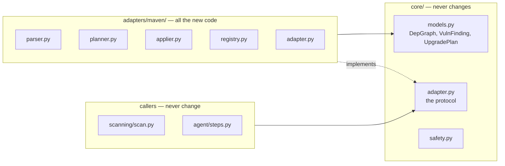

# Adding an ecosystem

The core is ecosystem-agnostic by construction: nothing outside
`adapters/npm/` knows what a `package.json` is. Adding Maven, PyPI or Go means
writing one module and registering it. **No core changes.**

- [The contract](#the-contract)
- [What you build](#what-you-build)
- [Registering it](#registering-it)
- [Testing it](#testing-it)
- [Worked sketch: Maven](#worked-sketch-maven)
- [Things that are easy to get wrong](#things-that-are-easy-to-get-wrong)

## The contract

```python
class EcosystemAdapter(Protocol):
    id: str                    # "npm", "maven", "pypi"
    osv_ecosystem: str         # what OSV calls it: "npm", "Maven", "PyPI"
    manifest_files: list[str]  # ["pom.xml"]

    def detect(self, repo_file_paths: list[str]) -> bool: ...
    def parse_dependencies(self, files: FileMap) -> DepGraph: ...
    def plan_upgrades(
        self,
        findings: list[VulnFinding],
        graph: DepGraph,
        *,
        allow_major_bumps: bool,
        registry: RegistryClient,
    ) -> UpgradePlan: ...
    def apply_upgrades(
        self, plan: UpgradePlan, files: FileMap, regenerator: LockfileRegenerator
    ) -> list[FilePatch]: ...
    def is_manifest_path(self, path: str) -> bool: ...
    def ci_hints(self) -> list[str]: ...
```

`id` and `osv_ecosystem` are separate on purpose: OSV spells npm `npm` but
Maven `Maven`, and getting that wrong means every query silently returns
nothing.



## What you build

### `detect(paths) -> bool`

Given the repository's root file names, does this ecosystem apply? Only the
root is checked, because the MVP scans `paths: ["."]`.

```python
def detect(self, repo_file_paths: list[str]) -> bool:
    return "pom.xml" in set(repo_file_paths)
```

### `parse_dependencies(files) -> DepGraph`

The main piece of work. You receive the manifest contents and must produce
every **installed** package and the edges between them.

```python
DepNode(purl=..., name=..., version=..., is_direct=..., is_dev=...)
DepEdge(parent="ROOT" | parent_purl, child=child_purl, requested_range=...)
```

Rules the core relies on:

- Purls come from `core/purl.py:make_purl(ecosystem, name, version)`.
- A direct dependency has an edge from the literal `ROOT`.
- The same package at two versions is two nodes with two purls.
- An unresolvable edge is dropped rather than guessed at.
- Unsupported input raises `UnsupportedLockfileError` with a message telling
  the user what to do about it.

This is where resolution semantics live. npm hoists and nests; Maven has
nearest-wins and `dependencyManagement`; pip has one flat environment. Each is
different, and each belongs entirely inside its adapter.

### `plan_upgrades(...) -> UpgradePlan`

Turn findings into actions. The three action types are shared, but what they
mean is yours:

| Action | npm | Maven |
|---|---|---|
| `BumpDirect` | rewrite the range in `dependencies` | rewrite `<version>` or a property |
| `BumpParent` | bump the parent that pulls it in | the same |
| `Override` | `overrides` | `<dependencyManagement>` |

Respect `allow_major_bumps`, report what you could not fix as `Unresolved`
with `no_fix`, `needs_major` or `conflict`, and merge actions on the same
package so the plan has one per package.

### `apply_upgrades(plan, files, regenerator) -> list[FilePatch]`

Write the plan into the manifest text and return the changed files.

**Preserve formatting.** The manifest is a file humans maintain; a reviewer
should see the version lines that changed and nothing else. For npm that means
key order, indentation and the trailing newline. For XML it means not
reserialising the document.

If your ecosystem has a lockfile that must be regenerated by a tool you cannot
run in-process, call `regenerator.regenerate(files)`. That protocol is how npm
reaches its Node helper, and the same mechanism is available to you.

### `is_manifest_path(path) -> bool`

Used by safety rule 2 to stop the model editing your manifests, and by the
push trigger to decide whether a commit could have changed the dependency
tree. Exact root paths, so a vendored `pom.xml` deep in the tree does not
count.

### `ci_hints() -> list[str]`

Short strings appended to the repair prompt. The useful ones name the failure
shapes specific to your ecosystem:

```python
"Errors referencing `node_modules` paths usually mean an API change in a "
"bumped package; check that package's changelog for breaking changes."
```

## Registering it

```python
# adapters/__init__.py
ADAPTERS: list[EcosystemAdapter] = [NpmAdapter(), MavenAdapter()]
```

That is the whole integration. `detect_adapters` picks whichever ones match,
or validates an explicit `ecosystems: [maven]` from the config and raises a
`ConfigError` naming the ecosystem if its files are absent.

## Testing it

Mirror the npm suite's structure, which is organised around behavior rather
than modules:

| File | Covers |
|---|---|
| `tests/fixtures/maven/*` | Real manifests: simple, nested, with a BOM, with properties |
| `test_maven_parser.py` | detection, graph building, resolution, rejected input |
| `test_maven_planner.py` | direct, parent, override, needs_major, no_fix, conflict |
| `test_maven_applier.py` | formatting preserved, each action type |
| `test_maven_registry.py` | version lists, dependency lookups, caching, 404s |

Use real manifests as fixtures, not hand-simplified ones. The npm parser's
handling of workspace links and scoped nesting exists because real lockfiles
contain them.

The planner tests use a `FakeRegistry` with a fixed catalogue, so planning is
deterministic and needs no network.

## Worked sketch: Maven

```python
# adapters/maven/adapter.py
class MavenAdapter:
    id = "maven"
    osv_ecosystem = "Maven"          # capital M, OSV's spelling

    def __init__(self) -> None:
        self.manifest_files = ["pom.xml"]

    def detect(self, repo_file_paths: list[str]) -> bool:
        return "pom.xml" in set(repo_file_paths)

    def parse_dependencies(self, files: FileMap) -> DepGraph:
        return parser.parse_pom(files)

    def plan_upgrades(self, findings, graph, *, allow_major_bumps, registry):
        return planner.plan_upgrades(
            findings, graph, allow_major_bumps=allow_major_bumps, registry=registry
        )

    def apply_upgrades(self, plan, files, regenerator):
        return applier.apply_upgrades(plan, files)   # no lockfile to regenerate

    def is_manifest_path(self, path: str) -> bool:
        return path in self.manifest_files

    def ci_hints(self) -> list[str]:
        return [
            "A NoSuchMethodError after an upgrade usually means a transitive "
            "dependency still resolves to the old version; check the effective "
            "POM rather than the declared one.",
        ]
```

The real work is `parse_pom`. A POM does not list its transitive tree, so you
either shell out to `mvn dependency:tree`, which the function runtime cannot
do, or resolve it yourself against Maven Central. Expect that to be most of
the effort, and note that the `RegistryClient` protocol already gives you the
shape for it.

## Things that are easy to get wrong

| Trap | What happens |
|---|---|
| Using `id` where `osv_ecosystem` belongs | Every OSV query returns nothing, silently |
| Building purls by hand | Scoped and encoded names drift from `core/purl.py` |
| Reserialising the manifest | A diff full of unrelated reformatting |
| Treating "the range allows a fixed version" as a fix | Covered in [upgrade planning](upgrade-planning.md#parent-bumps) |
| Guessing at an unresolvable edge | A graph that says something untrue |
| Forgetting `is_manifest_path` | Safety rule 2 stops protecting your manifests |
| Returning the same node twice | Keyed by purl, so it collapses, but the edges will be wrong |
