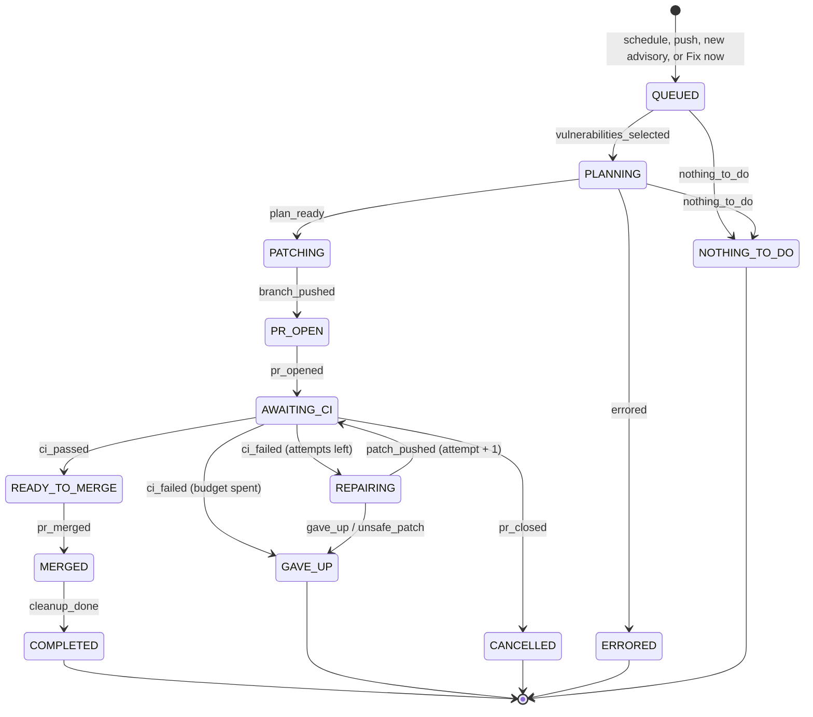
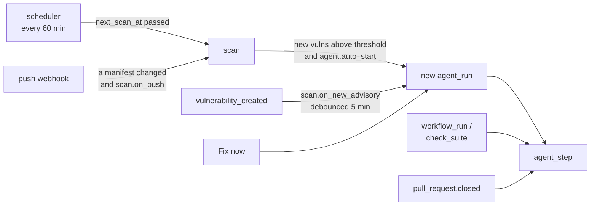
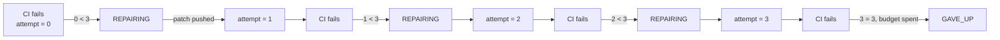

# The agent

The agent is a state machine stored in a database row. Each function execution
loads a run, performs exactly one transition, writes the result, and exits.
"Sleeping" is not a state the agent sits in: it is the absence of an active run.

- [States](#states)
- [Transitions in detail](#transitions-in-detail)
- [The pure core](#the-pure-core)
- [What wakes it](#what-wakes-it)
- [Attempt accounting](#attempt-accounting)
- [Concurrency and idempotency](#concurrency-and-idempotency)
- [Terminal states and cleanup](#terminal-states-and-cleanup)
- [The timeline](#the-timeline)

## States



`pr_closed` and `errored` are available from **any** non-terminal state, not
just the two drawn above; the diagram would be unreadable with every edge.

| State | Meaning | Who moves it on |
|---|---|---|
| `QUEUED` | A run exists, nothing claimed yet | The agent, immediately |
| `PLANNING` | Vulnerabilities claimed, working out the upgrade | The agent, immediately |
| `PATCHING` | Plan ready, writing files and committing | The agent, immediately |
| `PR_OPEN` | Branch pushed, opening the pull request | The agent, immediately |
| `AWAITING_CI` | Waiting for GitHub Actions | A `workflow_run` or `check_suite` webhook |
| `REPAIRING` | CI failed, working on a patch | The agent, immediately |
| `READY_TO_MERGE` | CI green | Auto-merge, or a human merging |
| `MERGED` | PR merged, closing the books | The agent, immediately |
| `COMPLETED` | Everything fixed and recorded | Terminal |
| `GAVE_UP` | Out of attempts, or the model declined | Terminal |
| `CANCELLED` | Someone closed the PR without merging | Terminal |
| `ERRORED` | Something unexpected broke | Terminal |
| `NOTHING_TO_DO` | Nothing eligible, or nothing upgradable | Terminal |

The states marked "the agent, immediately" re-enqueue themselves: `agent_step`
returns `reschedule: true` and the function queues another execution of itself.
`AWAITING_CI` and `READY_TO_MERGE` do not, because something outside has to
happen first.

## Transitions in detail

### QUEUED → PLANNING

Selects the vulnerabilities this run will fix. A vulnerability is eligible when
all of these hold:

- status is `open` or `in_progress`
- `fixed_version` is set (an advisory with no fix cannot be acted on)
- severity meets `agent.severity_threshold`
- the advisory is not in `agent.ignore`, or its ignore rule has expired

Claimed vulnerabilities are marked `in_progress`, which stops a concurrent scan
from reopening or resolving them mid-run. If nothing is eligible, the run ends
in `NOTHING_TO_DO` rather than opening an empty pull request.

### PLANNING → PATCHING

Reads the manifests at the default branch head, builds the dependency graph,
and asks the adapter for an upgrade plan. The plan is stored as `plan_json` on
the run so `PATCHING` does not recompute it, and `base_sha` is recorded so the
commit is built against the tree that was planned against.

Anything the planner could not resolve is written back onto the vulnerability
row: `needs_major` when a fix exists but crosses a major and the repo has not
opted in, `unfixable` otherwise. Those rows then show on the dashboard with a
reason instead of silently staying open.

### PATCHING → PR_OPEN

Applies the plan to the manifest, regenerates the lockfile through the Node
helper, creates `vulnagent/{run id}`, and commits both files in one commit:

```
fix(deps): resolve 4 vulnerabilities [vulnagent]
```

The `[vulnagent]` suffix is how the agent recognises its own commits later. If
the plan turns out to change no files, the run ends in `NOTHING_TO_DO` rather
than creating an empty commit.

### PR_OPEN → AWAITING_CI

Opens the pull request with the body from [the PR template](#the-timeline),
adds the `vulnagent` label, and records `pr_number` and `pr_url` so a
`pull_request` webhook can find the run again.

### AWAITING_CI → REPAIRING or READY_TO_MERGE or GAVE_UP

Driven entirely by webhooks. See [CI repair](ci-repair.md) for what `REPAIRING`
actually does.

A repository with no workflows at all would wait forever, so `check_outcome`
treats "no check runs" as success.

### READY_TO_MERGE

With `agent.auto_merge: true` the agent squash-merges. Otherwise it comments
"Ready for review ✅" and waits for a human. Either way the next move comes from
a `pull_request.closed` webhook.

### MERGED → COMPLETED

Marks the claimed vulnerabilities `fixed` with `resolved_by_run_id`, writes a
success memory if the run needed at least one repair, recomputes the severity
counts on the repo, and logs the final timeline entry.

## The pure core

`agent/state_machine.py` has no I/O at all. It is a function over a snapshot:

```python
def next_state(run: RunSnapshot, event: AgentEvent) -> Transition
```

`RunSnapshot` is three fields: `state`, `attempt`, `max_attempts`. `Transition`
is the destination plus an `attempt_delta`. That is the whole interface.

This split is what makes the attempt budget testable without a database, a
GitHub token or a model. `tests/test_state_machine.py` covers every transition,
every interrupt, and the boundary where the budget runs out, in milliseconds.

`agent/steps.py` holds the effects. It calls `next_state` to decide, performs
the work, writes the row, logs the event, and releases the repository if the
destination is terminal.

## What wakes it



All of these are handlers inside the one `hydra` function, handing off to each
other as signed async tasks (see
[One function, six handlers](architecture.md#one-function-six-handlers)).
Each of those decisions lives in `services/triggers.py` rather than inside a
handler, so each is unit-tested: whether a push touched a manifest,
when the next scheduled scan is due, whether a scan's findings justify starting
a run, and whether a CI result belongs to this run at all.

## Attempt accounting

The budget is `agent.max_ci_retries`, clamped to a hard ceiling of 5 by
`core/safety.py:capped_retries` no matter what the repo config says.



The attempt increments on `patch_pushed`, not on `ci_failed`. A failure that
produces no patch, because the model gave up or the patch was unsafe, does not
burn an attempt; it ends the run directly.

With `max_ci_retries: 0` the first failure gives up immediately, which is the
right behavior for a repo that wants the PR but not the repair loop.

## Concurrency and idempotency

**One run per repository.** `repos.active_run_id` is set when a run starts and
cleared when it reaches a terminal state. *Fix now* on a repo that already has
one returns "already working" with the existing run id rather than starting a
second.

> There is a race window between reading `active_run_id` and writing it. Two
> simultaneous *Fix now* presses could both see null. In practice the dashboard
> disables the button while a run is active, and the cost is a duplicate PR
> rather than anything destructive. Recorded in [DECISIONS.md](DECISIONS.md).

**Webhook deliveries are claimed once.** `webhook_deliveries` has a unique index
on `delivery_id`, and the row is inserted before any processing. A redelivery
hits the constraint, returns 200, and stops. GitHub retries deliveries
liberally, so this matters more than it looks.

**Async executions carry their expectation.** The payload is
`{run_id, expected_state}`. If the stored state no longer matches, the execution
logs and exits without acting. This is what makes a duplicate or delayed
execution harmless.

**CI events are matched to a commit.** A `workflow_run` for any SHA other than
the run's `head_sha` is ignored, so an old workflow finishing after a repair was
pushed cannot move the run backwards.

## Terminal states and cleanup

Every terminal state goes through the same cleanup:

| Terminal state | `agent_state` | Vulnerabilities | Extra |
|---|---|---|---|
| `COMPLETED` | `idle` | marked `fixed` | success memory written |
| `GAVE_UP` | `idle` | back to `open` | PR comment, `vulnagent:needs-human` label, failure memory |
| `CANCELLED` | `idle` | back to `open` | nothing else |
| `ERRORED` | `error` | back to `open` | `last_error` on the run |
| `NOTHING_TO_DO` | `idle` | back to `open` | nothing else |

Releasing the vulnerabilities matters: a run that claimed four advisories and
then gave up must not leave them `in_progress` forever, or the next run would
find nothing eligible and the dashboard would show work that is not happening.

## The timeline

Every transition writes an `agent_events` row, which is what the dashboard
subscribes to. Event types are deliberately specific so the UI can style them:

| Type | When | Shown as |
|---|---|---|
| `state_change` | Any ordinary transition | Grey |
| `pr_opened` | The pull request exists | Accent, with the number |
| `ci_failed` | A workflow came back red | Red |
| `ci_passed` | All checks green | Green |
| `memory_hit` | A past fix matched above the threshold | Amber, highlighted row |
| `patch_pushed` | A repair was committed | Accent, carries the model's analysis |
| `gave_up` | Out of attempts or declined | Red |
| `merged` | The PR merged | Green |
| `error` | Something broke | Red |

The same analysis text is written into the pull request body, between
`<!-- vulnagent:log:start -->` and `<!-- vulnagent:log:end -->` markers, so each
repair rewrites only that section and anything a reviewer added to the body
survives.
