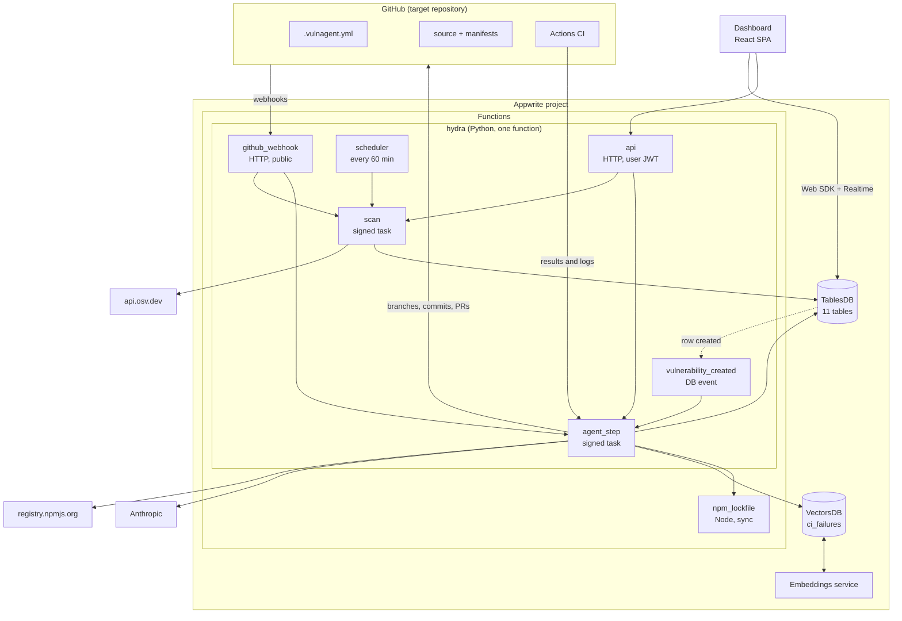
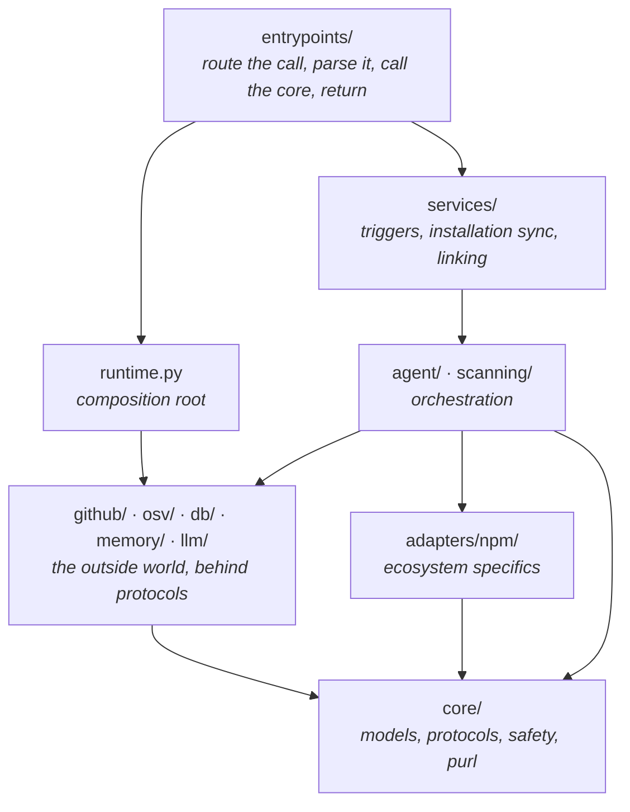
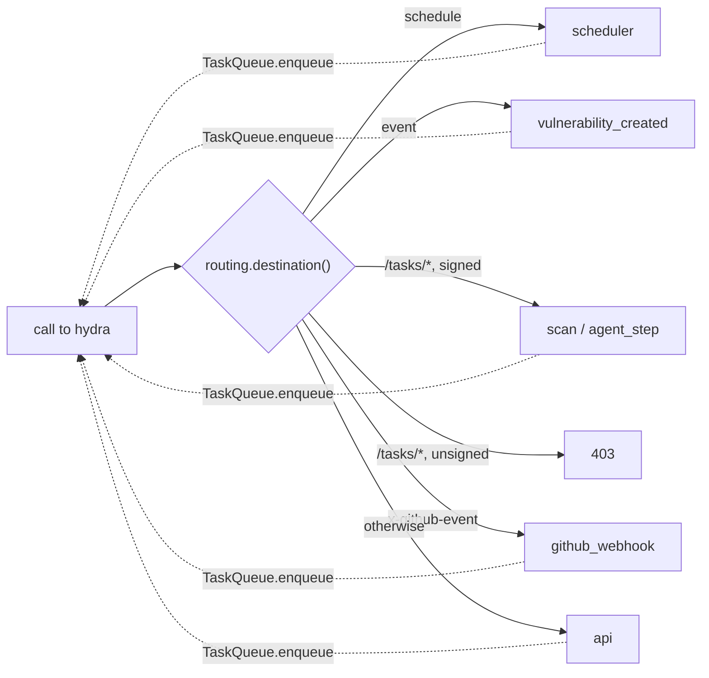
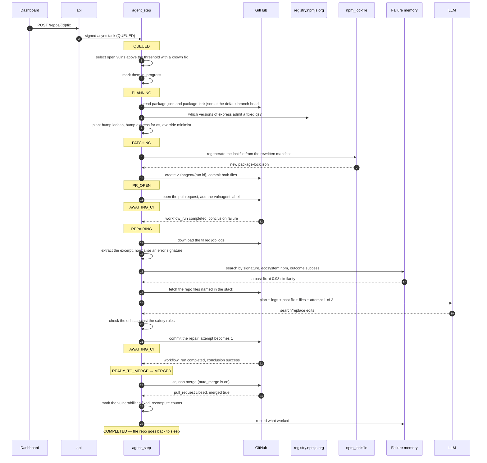
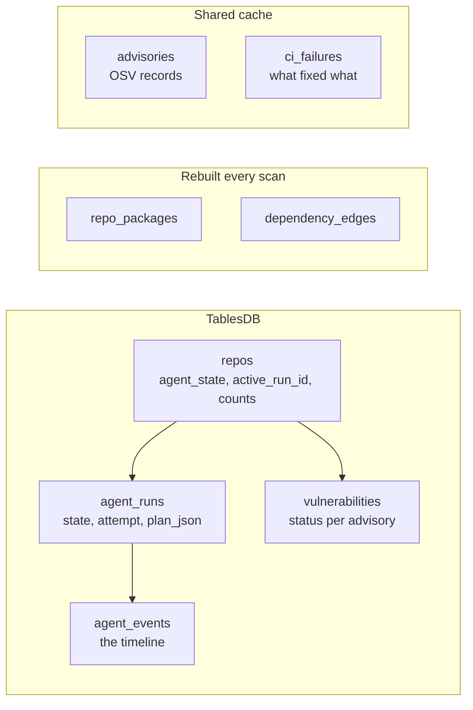

# Architecture

How the pieces fit, why the boundaries are where they are, and what happens
between a webhook arriving and a pull request merging.

- [The shape of the system](#the-shape-of-the-system)
- [Layering](#layering)
- [What runs where](#what-runs-where)
- [One function, six handlers](#one-function-six-handlers)
- [A run, end to end](#a-run-end-to-end)
- [The four design principles](#the-four-design-principles)
- [Where state lives](#where-state-lives)
- [Failure handling](#failure-handling)

## The shape of the system

Nothing polls GitHub. Every transition is driven by a webhook, a cron tick, a
database event, or a dashboard button.

The six Python handlers are one Appwrite function, `hydra`, because the free
plan allows only two functions. An arrow between two handlers inside `hydra`
is the function executing itself asynchronously on a signed task path; see
[One function, six handlers](#one-function-six-handlers).

## Layering

The dependency arrows all point one way. Nothing in `core/` imports Appwrite,
GitHub or httpx, which is why most of the system can be tested without them.

| Layer | Rule it follows | Why it matters |
|---|---|---|
| `core/` | No I/O, no vendor SDKs | The rules and models stay testable and reusable |
| `adapters/` | Knows one ecosystem, implements `EcosystemAdapter` | Adding Maven touches nothing else |
| `db/`, `github/`, `osv/`, `memory/`, `llm/` | One module per external system, behind a protocol | Each is swappable and stubbable |
| `agent/`, `scanning/` | Orchestration only, no vendor calls of their own | Decisions stay separable from effects |
| `services/` | The decisions a function would otherwise inline | Trigger logic is unit-tested, not deploy-tested |
| `entrypoints/` | Route, parse, delegate, return | Nothing worth testing lives in a file you cannot import |

The one rule with teeth: **no raw Appwrite SDK call exists outside `db/` and
`memory/`**. Everything else works with the typed models in `db/rows.py`.

## What runs where

Two Appwrite functions. `hydra` (Python, 900s timeout) holds six handlers in
`backend/src/vulnagent/entrypoints/`; `npm_lockfile` (Node, 300s) is the
lockfile helper.

| Handler | Module | Reached by | Does |
|---|---|---|---|
| `github_webhook` | `github_webhook.py` | HTTP, public | Verify the signature, claim the delivery, route, return |
| `scheduler` | `scheduler.py` | 60-minute interval | Find repos whose `next_scan_at` has passed, enqueue scans |
| `scan` | `scan.py` | signed task, `/tasks/scan` | Manifests to findings to rows to counts |
| `agent_step` | `agent_step.py` | signed task, `/tasks/agent-step` | Advance one run by exactly one transition |
| `vulnerability_created` | `vulnerability_created.py` | DB row-create event | Maybe start a run for a newly discovered advisory |
| `api` | `api.py` | HTTP, user JWT | Dashboard actions: link, scan now, fix now |
| `npm_lockfile` | separate Node function | sync execution | `npm install --package-lock-only --ignore-scripts` |

`github_webhook` never does real work itself. It returns quickly and hands
everything heavier to a signed async task, because GitHub will retry a
delivery that takes too long.

## One function, six handlers

`backend/functions/hydra/src/main.py` re-exports
`vulnagent.entrypoints.main.main`, which asks `routing.destination()` which
handler a call belongs to, checked in this order:

| Call | Recognised by | Handler |
|---|---|---|
| 60-minute interval | `x-appwrite-trigger: schedule` | `scheduler` |
| DB event `databases.vulnagent.tables.vulnerabilities.rows.*.create` | `x-appwrite-trigger: event` | `vulnerability_created` |
| Internal task | path `/tasks/scan` or `/tasks/agent-step` with a valid `x-hydra-signature` | `scan` / `agent_step` |
| GitHub | an `x-github-event` header | `github_webhook` |
| Anything else | | `api` (user JWT) |

A task path without a valid signature gets 403.

### Why tasks are signed

Hand-offs between handlers (`app.enqueue("scan", ...)`,
`app.enqueue("agent_step", ...)`) go through `entrypoints/tasks.py`
`TaskQueue`, which queues an async execution of the same function
(`APPWRITE_FUNCTION_ID`, injected by Appwrite, default `hydra`) on the task
path. The function must be executable by `any` so GitHub can reach it, so
anyone can call `/tasks/agent-step`. The path alone proves nothing.

Each task body is therefore signed with HMAC-SHA256 keyed with
`APPWRITE_API_KEY`, sent as `x-hydra-signature: sha256=<hex>` (the same format
as GitHub's `X-Hub-Signature-256`). Only the deployment holds that key. An
empty key refuses every task.

## A run, end to end

Each numbered step above is a separate execution of `hydra` wherever an arrow
leaves the diagram and comes back. Nothing waits in memory for GitHub.

## The four design principles

### 1. The core is ecosystem-agnostic

Nothing outside `adapters/npm/` knows what a `package.json` is. The scanner and
the agent call `EcosystemAdapter` methods and work with `DepGraph`,
`VulnFinding` and `UpgradePlan`. See [Adding an ecosystem](adapters.md).

### 2. The agent is a persisted state machine

One execution loads a run, performs one transition, saves, and exits. There is
no long-running process, so there is nothing to lose when a function restarts,
and any step can be retried. The decision is a pure function
(`agent/state_machine.py`), the effects are separate (`agent/steps.py`).
See [The agent](agent.md).

### 3. Manifest changes are deterministic; the model only fixes breakage

Which version to upgrade to is computed from OSV data and the registry, never
guessed by a model. The LLM is reached for only after CI fails, and only to
change application code. See [Upgrade planning](upgrade-planning.md) and
[CI repair](ci-repair.md).

### 4. CI is the test runner

VulnAgent never executes a target repository's code. The only place `npm` runs
is the Node helper function, always with `--ignore-scripts`, and it only ever
resolves a lockfile. Whether an upgrade actually works is answered by the
repository's own CI.

## Where state lives

- **`repos.active_run_id`** is the concurrency lock. At most one run per repo.
- **`agent_runs.state`** is the resume point. A function execution is stateless;
  the row is the truth.
- **`repo_packages` and `dependency_edges`** are a snapshot, deleted and
  rewritten on every scan rather than merged.
- **`advisories`** is a global cache keyed by OSV id, shared across every repo.
- **`ci_failures`** is the only state that improves with age.

## Failure handling

| Failure | What happens |
|---|---|
| Webhook redelivered | `webhook_deliveries` claims the id; the second attempt returns 200 and stops |
| Two CI events for the same run | Events for any SHA other than `head_sha` are ignored |
| Stale async execution | `agent_step` compares `expected_state` with the stored state and exits if they differ |
| A step raises | The run moves to `ERRORED`, the repo is released, the error is on the timeline |
| CI never goes green | The attempt budget runs out, the run gives up, the PR is labelled for a human |
| Model returns nonsense | Reparsed once with the validation error, then the run gives up |
| Model returns something unsafe | Refused by `core/safety.py` before anything is committed |
| Appwrite is down mid-run | The run stays where it was; the next trigger resumes it from the row |

The common thread: no failure leaves a repository stuck with
`agent_state: working` and no run to advance it. Every terminal state releases
the lock.
