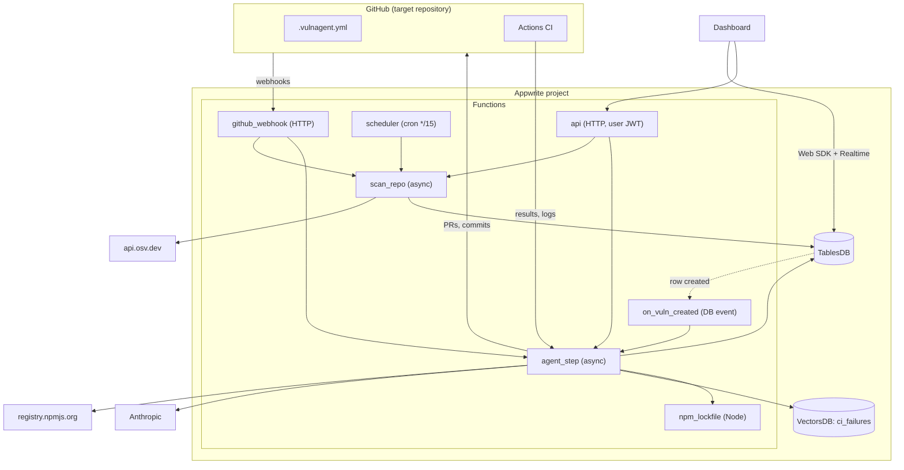
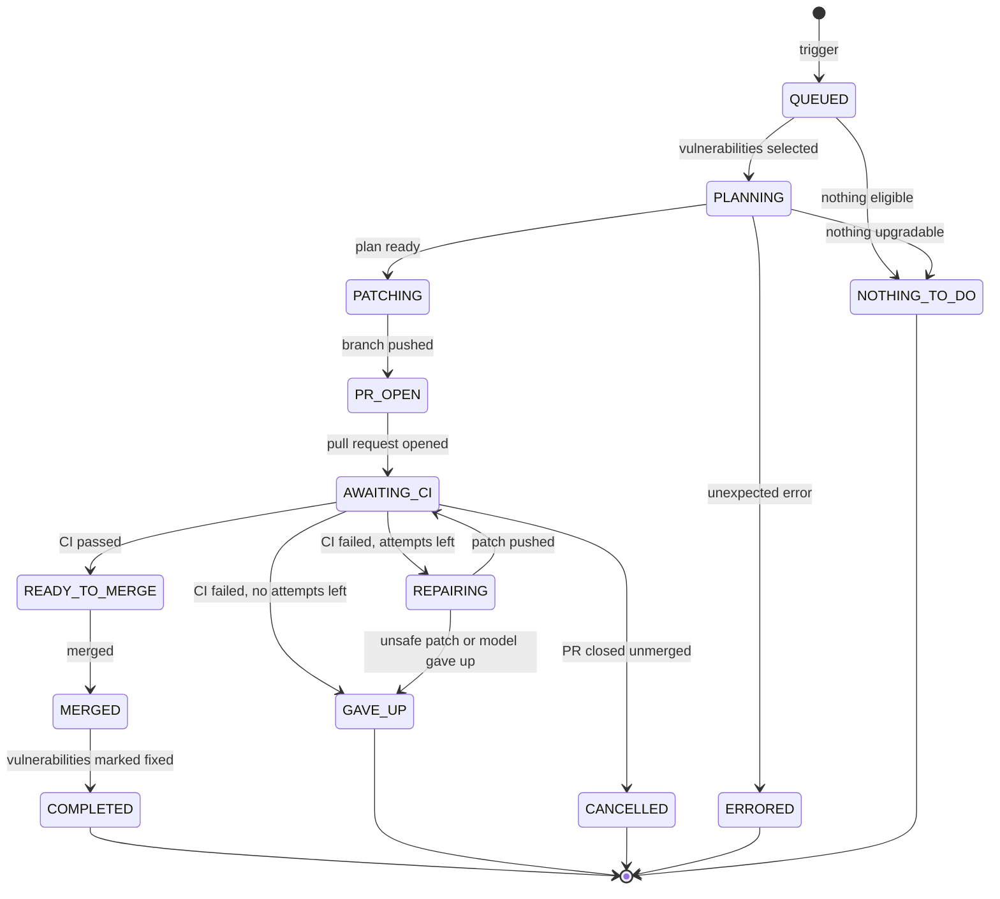
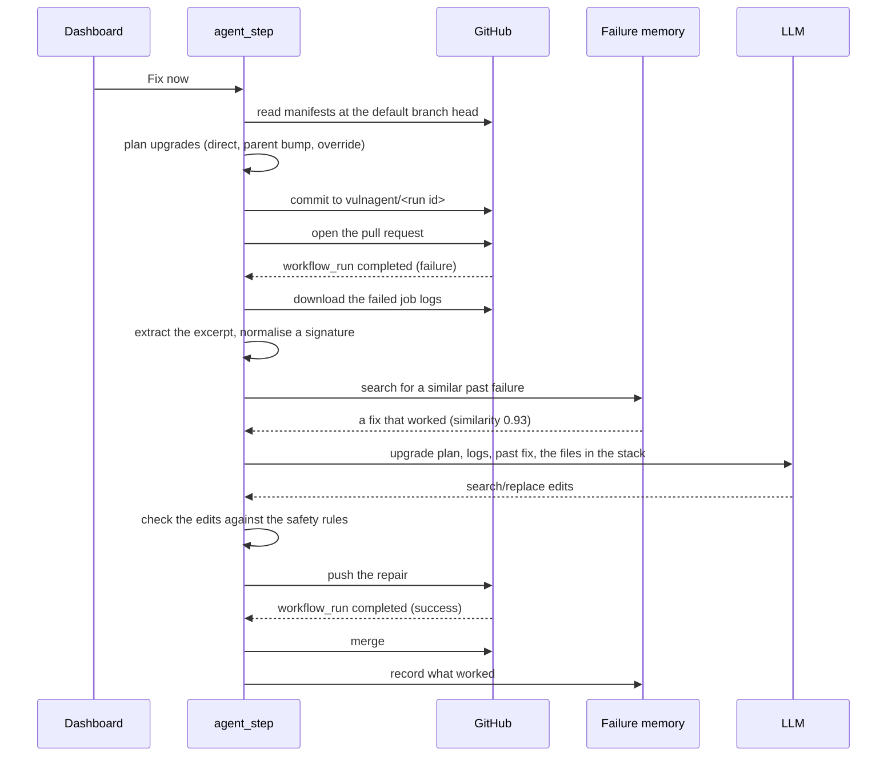

# Architecture

## Components

The core never parses `package.json`. It calls `EcosystemAdapter` methods, so
adding Maven or PyPI means adding a module under `adapters/` and registering
it: no change to the agent, the scanner or the database.

## The agent state machine

Terminal states release the repository: `active_run_id` goes back to null and
`agent_state` to `idle`. That is what "sleeping" means.

The decision half is a pure function, `agent/state_machine.py:next_state`. The
side effects live in `agent/steps.py`. Keeping them apart is what makes the
attempt accounting that stops the repair loop testable on its own.

## A run, end to end

## Why these boundaries

**The agent is a persisted state machine, not a long-running process.** Each
execution loads a run, performs one transition, saves and exits, so nothing
depends on a process staying alive and any step can be retried.

**Manifest changes are deterministic; the model only fixes breakage.** Which
version to upgrade to is computed from OSV data and the registry. The LLM is
reached for only when CI breaks, and only to change application code.

**CI is the test runner.** VulnAgent never executes a target repository's code;
`npm install` always runs with `--ignore-scripts`, in the one Node function
that exists for that purpose.

**Safety rules are code, not prompt text.** `core/safety.py` enforces them and
`tests/test_safety.py` covers each one. The prompt asks the model to behave;
the rules are what stop it when it does not.
