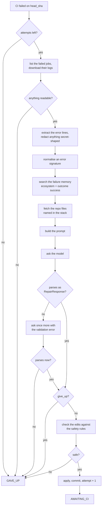
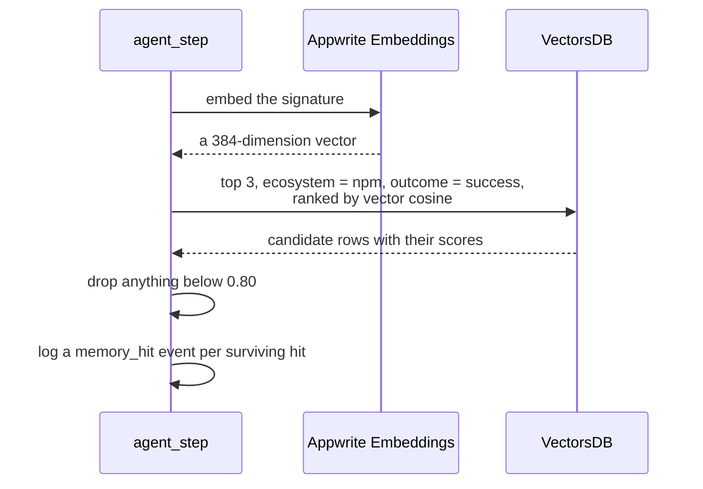
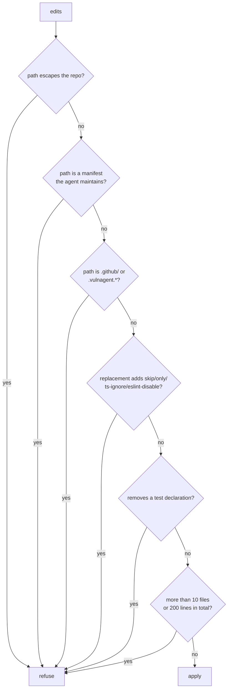

# CI repair

The upgrade is correct and CI is red anyway, because the new version changed an
API the project uses. This is the only place a language model is involved, and
the only thing it is allowed to change is application code.

- [The loop](#the-loop)
- [Reading the logs](#reading-the-logs)
- [Error signatures](#error-signatures)
- [Recalling a past fix](#recalling-a-past-fix)
- [Gathering context](#gathering-context)
- [The prompt](#the-prompt)
- [The response contract](#the-response-contract)
- [Validation](#validation)
- [Applying the patch](#applying-the-patch)
- [Giving up](#giving-up)

## The loop



Implemented in `agent/steps.py:_repairing`, with the log work in
`agent/ci_logs.py` and the contract in `llm/schemas.py`.

## Reading the logs

A GitHub Actions job log is mostly noise: setup steps, dependency installs,
timestamps on every line. `extract_excerpt` keeps the lines that describe a
failure and drops the rest.

A line is kept when it matches any of:

| Pattern | Catches |
|---|---|
| `error` (any case) | Most runners' failure lines |
| `FAIL` / `FAILED` | Test runner summaries |
| `\w*(Error\|Exception)` | `TypeError`, `AssertionError`, `ReferenceError` |
| `^npm ERR!` | npm's own failures |
| `^\s+at ` | Stack frames |
| `TS\d{4}` | TypeScript diagnostics |
| `Expected` / `Received` | Assertion diffs |

Before any of that, the Actions timestamp prefix
(`2024-03-21T12:34:56.7890123Z `) is stripped, and `##[group]` /
`##[endgroup]` workflow commands are dropped.

The result is capped at **4 KB**, keeping the **tail** rather than the head:
the last failure is the one that explains the run, and an early warning is
rarely what broke it. A log with nothing error-shaped at all falls back to its
last 40 lines, so a silent crash still produces something to look at.

Finally the whole excerpt goes through `redact_secrets`, which is safety rule 6.
A token that leaked into a log must not then be handed to a model.

## Error signatures

The same failure looks different on every run: timestamps move, the runner's
absolute paths differ, durations change. A signature strips all of that so two
runs of the same break produce the same string.

| Normalised | Example before | After |
|---|---|---|
| Hex hashes | `commit 3f2a1b9c4d5e...` | `commit <hash>` |
| Temp directories | `/tmp/vitest-7f3a9c/run.js` | `/tmp/<temp>/run.js` |
| Runner path prefixes | `/home/runner/work/app/app/src/auth.ts` | `src/auth.ts` |
| Line and column | `src/auth.ts:12:19` | `src/auth.ts` |
| TS diagnostic positions | `src/auth.ts(12,19)` | `src/auth.ts` |
| Durations | `failed in 1.23s` | `failed in <duration>` |
| Timestamps | `2024-03-21T12:34:56` | `<time>` |
| Whitespace runs | any | single space |

Capped at 1000 characters, which is plenty for an embedding and keeps the
vector column small.

```
TypeError: jwt.sign is not a function at signToken (src/auth.ts)
```

That string is both the memory key and part of what gets embedded.

## Recalling a past fix



The ecosystem filter is not optional: a Python fix for a `TypeError` is noise
when repairing an npm upgrade. Only `success` rows are offered as hints;
failures are recorded too, but for analysis rather than suggestion.

Each hit becomes a prompt section:

```
Similarity 0.93. Packages changed: jsonwebtoken 8.5.1->9.0.2.
Error was:
TypeError: jwt.sign is not a function at signToken (src/auth.ts)
Fix that worked:
jsonwebtoken 9 removed the callable form of the default export.
- import jwt from 'jsonwebtoken'
+ import * as jwt from 'jsonwebtoken'
```

Full details in [Failure memory](memory.md).

## Gathering context

The model needs the code, not just the error. `referenced_repo_files` pulls
file paths out of the excerpt, from stack frames and TypeScript diagnostics,
and filters hard:

- anything under `node_modules/` is dropped — the fix is never in a dependency
- absolute runner paths are cut back to their repository-relative part
- a path has to look like a source file, so `jwt.sign` in an error message is
  not mistaken for one
- at most **5 files**, each truncated to its first **300 lines**

Files are fetched from the run's branch, not the default branch, so the model
sees the code as it currently is after any earlier repair.

## The prompt

The system prompt states the rules; `core/safety.py` is what enforces them.
Both exist because a model told not to weaken a test still sometimes does.

The user content is seven labelled sections:

| Section | Contents |
|---|---|
| `UPGRADE_PLAN` | What changed, as `package from->to` pairs |
| `CI_LOG_EXCERPT` | The redacted excerpt |
| `SIMILAR_PAST_FIXES` | 0 to 3 memory hits, or `(none)` |
| `FILES` | Each context file, fenced and labelled with its path |
| `ECOSYSTEM_HINTS` | From `adapter.ci_hints()` |
| `ATTEMPT` | `2 of 3` |
| `PREVIOUS_ATTEMPTS` | What was already tried, or `(none)` |

The assembled prompt goes through `redact_secrets` as well, because a source
file can contain a hard-coded credential.

Temperature is **0**. A repair step that produced different output on identical
input would make failures impossible to reason about.

## The response contract

```json
{
  "analysis": "jsonwebtoken 9 returns a promise instead of taking a callback.",
  "edits": [
    { "path": "src/auth.ts", "search": "jwt.sign(payload)", "replace": "await jwt.sign(payload)" }
  ],
  "confidence": 0.9,
  "give_up": false,
  "give_up_reason": null
}
```

Parsing is forgiving about packaging and strict about content. A ` ```json `
fence is stripped, prose around the object is ignored, and a bare object is
found inside surrounding text. But a missing `analysis`, a malformed edit, or
a `confidence` outside 0 to 1 is a rejection.

Rejection messages are written to be handed straight back:

```
the response did not match the contract: analysis: Field required
```

That exact text is appended to the prompt on the single retry.

## Validation

Before anything is committed, `review_edits` applies safety rules 2, 3 and 4.
See [Safety rules](safety.md) for the full list.



A refusal is not a retry. The run moves to `GAVE_UP` with the reason on the
timeline, because a model that tried to disable a test is unlikely to do better
with another go, and the attempt budget is better spent by a human.

## Applying the patch

Each edit's `search` string must appear **exactly once** in its file. Zero
matches or two matches is an error, not a guess: a replace-first-occurrence on
an ambiguous match is how a repair silently corrupts a file.

The changed files are committed to the run's branch in one commit:

```
fix(ci): jsonwebtoken 9 returns a promise instead of ta [vulnagent]
```

`head_sha` is updated so the next CI result can be matched to this commit, the
attempt counter increments, and the model's `analysis` goes onto both the
timeline and the pull request's agent log section.

## Giving up

| Cause | Attempt burned? |
|---|---|
| Budget exhausted | n/a, it was already spent |
| Model set `give_up: true` | No |
| Response unparseable twice | No |
| Edits failed validation | No |
| No readable log | No |
| No LLM configured | No |

On giving up the agent:

1. sets the claimed vulnerabilities back to `open`
2. writes a `failed` memory row
3. comments on the pull request explaining how many attempts were made
4. adds the `vulnagent:needs-human` label
5. leaves the branch and the PR in place

Nothing is reverted. The partial work is usually most of the fix, and a human
picking it up wants the branch, not a clean slate.
