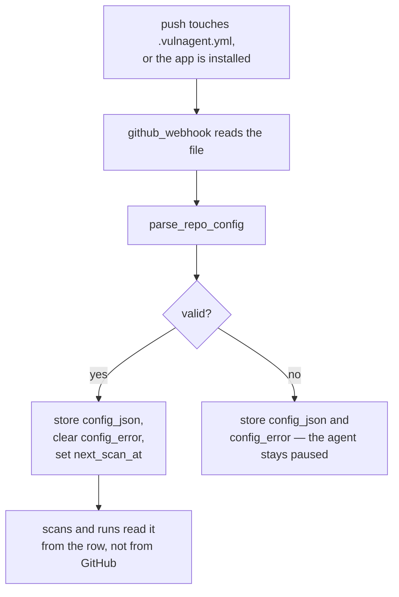

# Configuration

Two separate things: the per-repository `.vulnagent.yml`, which the repository
owns, and the process environment, which the deployment owns.

- [Repository config](#repository-config)
- [Every field](#every-field)
- [How it is loaded](#how-it-is-loaded)
- [Invalid config](#invalid-config)
- [Ignore rules](#ignore-rules)
- [Environment variables](#environment-variables)
- [What is required to boot](#what-is-required-to-boot)
- [Recipes](#recipes)

## Repository config

Drop `.vulnagent.yml` (or `.yaml`, or `.json`) in the repository root. Every
field has a default, so the minimum viable file is one line:

```yaml
version: 1
```

The full shape, with defaults shown:

```yaml
version: 1
enabled: true
ecosystems: auto            # "auto", or a list like [npm]
paths: ["."]                # MVP: only the repository root

scan:
  schedule: "0 6 * * *"     # cron, UTC. null disables scheduled scans
  on_push: true             # rescan when a manifest changes on the default branch
  on_new_advisory: true     # react to newly published advisories

agent:
  auto_start: true          # false means only "Fix now" starts a run
  severity_threshold: high  # low | medium | high | critical
  max_ci_retries: 3         # hard ceiling of 5
  auto_merge: false
  allow_major_bumps: false
  grouping: single_pr       # single_pr | per_package (per_package not built yet)
  ignore:
    - id: GHSA-xxxx-xxxx-xxxx
      reason: "Not reachable in our usage"
      expires: 2026-12-31   # optional
```

## Every field

### Top level

| Field | Type | Default | Notes |
|---|---|---|---|
| `version` | `1` | `1` | Only 1 is understood; anything else is an error |
| `enabled` | bool | `true` | `false` stops the agent entirely, scans included |
| `ecosystems` | `"auto"` or list | `"auto"` | An explicit ecosystem whose files are absent is an error |
| `paths` | list | `["."]` | Only the root is supported; anything else is rejected |

### `scan`

| Field | Type | Default | Notes |
|---|---|---|---|
| `schedule` | cron string or null | `"0 6 * * *"` | UTC. Validated with `croniter` |
| `on_push` | bool | `true` | Only manifest changes on the default branch trigger |
| `on_new_advisory` | bool | `true` | Debounced to one run per 5 minutes |

### `agent`

| Field | Type | Default | Notes |
|---|---|---|---|
| `auto_start` | bool | `true` | `false` leaves scanning on but waits for a human |
| `severity_threshold` | enum | `high` | `unknown` counts as `low` |
| `max_ci_retries` | int | `3` | Clamped to 5; `0` means open the PR but never repair |
| `auto_merge` | bool | `false` | Squash merge when CI is green |
| `allow_major_bumps` | bool | `false` | Includes `0.x` minor bumps |
| `grouping` | enum | `single_pr` | `per_package` is accepted but not implemented |
| `ignore` | list | `[]` | See below |

## How it is loaded



The raw file text is stored on the repo row and reparsed when needed, rather
than being normalised at write time. That keeps what the user actually wrote
visible on the dashboard, including the parts a future schema version might
read differently.

Parsing is `yaml.safe_load` only. A `!!python/object/apply` tag is an error,
not an instruction.

## Invalid config

An invalid config does not crash anything and does not fall back to defaults.
It is stored as `config_error` and the agent stays paused for that repository,
with the message shown on the dashboard:

```
.vulnagent.yml: agent.max_ci_retries: Input should be less than or equal to 5
```

Unknown keys are rejected rather than ignored:

```yaml
version: 1
enabeld: false    # error: enabeld — Extra inputs are not permitted
```

A typo that silently left the agent enabled would be worse than a visible
error. The same reasoning applies to `paths`: multi-path support is a non-goal
for now, so accepting the value and ignoring it would mislead.

## Ignore rules

```yaml
agent:
  ignore:
    - id: GHSA-aaaa-bbbb-cccc
      reason: "The vulnerable code path is not reachable from our entry points"
      expires: 2026-12-31
```

`reason` is required. An ignore without a stated reason is a decision nobody
can review later.

`expires` is optional and **inclusive**: a rule expiring `2026-12-31` applies
on the 31st and not on the 1st. When it expires the vulnerability returns to
`open` at the next scan and becomes eligible again.

Ignored advisories are still recorded and still shown on the dashboard. They
are excluded from the counts and never picked up by a run.

## Environment variables

### Appwrite

| Variable | Required | Notes |
|---|---|---|
| `APPWRITE_ENDPOINT` | yes | `https://cloud.appwrite.io/v1` unless self-hosting |
| `APPWRITE_PROJECT_ID` | yes | |
| `APPWRITE_API_KEY` | yes | Server key; scopes in [setup](setup.md). Also signs internal tasks: empty means every task is refused |

### GitHub

| Variable | Required | Notes |
|---|---|---|
| `GITHUB_APP_ID` | yes | The numeric id, not the slug |
| `GITHUB_APP_PRIVATE_KEY` | yes | The PEM. One line with `\n` escapes is accepted and unescaped |
| `GITHUB_WEBHOOK_SECRET` | yes | Must match the app exactly |
| `GITHUB_APP_SLUG` | no | Builds the install link in the dashboard |

### The model

| Variable | Required | Notes |
|---|---|---|
| `LLM_API_KEY` | no | Without it, scans and PRs work but CI repair does not |
| `LLM_MODEL` | no | Defaults to `claude-opus-5` in `.env.example` |

### Embeddings

| Variable | Required | Notes |
|---|---|---|
| `EMBEDDING_MODEL` | no | `all-minilm` (384) or `nomic-embed-text` (768) |
| `EMBEDDING_DIM` | no | Must match the model; fixes the vector column width |
| `EMBEDDING_API_KEY` | no | **Unused.** Appwrite provides embeddings itself |

### Other

| Variable | Required | Notes |
|---|---|---|
| `OSV_BASE_URL` | no | Defaults to `https://api.osv.dev`; point at a mirror if you have one |
| `NPM_LOCKFILE_FUNCTION_ID` | for patching | The deployed Node function's id |

Internal tasks go to the function named by `APPWRITE_FUNCTION_ID`, which
Appwrite injects into every execution (default `hydra`). There is nothing to
set.

### Dashboard (public values only)

| Variable | Notes |
|---|---|
| `VITE_APPWRITE_ENDPOINT` | |
| `VITE_APPWRITE_PROJECT_ID` | **Empty means demo mode** |
| `VITE_API_FUNCTION_ID` | `hydra`, the function whose `api` handler serves the dashboard |
| `VITE_GITHUB_APP_SLUG` | |

## What is required to boot

Only the Appwrite and GitHub credentials. Everything else is optional, and the
code that needs it says so by name at the point of use:

```python
settings.require_llm()        # ConfigError: LLM_API_KEY is not set
settings.require_embeddings() # ConfigError: EMBEDDING_DIM is not set
```

This is deliberate. A scan-only deployment is a legitimate configuration, and
a missing optional key should fail loudly in the one step that needs it rather
than preventing the process from starting.

`make doctor` reports which variables are still empty.

Secrets are `SecretStr`, so printing or logging a settings object cannot leak
them:

```python
>>> repr(load_settings())
Settings(appwrite_api_key=SecretStr('**********'), ...)
```

`.env` is **not** read unless a caller asks (`load_settings(dotenv=".env")`).
Deployed functions get their variables from the platform; local scripts opt in.
Reading it by default would make the test suite depend on whether a developer
happened to have one on disk.

## Recipes

**Watch, but never act on its own**

```yaml
version: 1
agent:
  auto_start: false
```

Scans run and the dashboard stays current; nothing opens a PR until someone
presses *Fix now*.

**Fully autonomous for a low-risk service**

```yaml
version: 1
agent:
  auto_start: true
  severity_threshold: medium
  auto_merge: true
  allow_major_bumps: true
  max_ci_retries: 5
```

**Critical only, and keep the robot off the merge button**

```yaml
version: 1
scan:
  schedule: "0 */6 * * *"
agent:
  severity_threshold: critical
  auto_merge: false
```

**Open the PR but never attempt a repair**

```yaml
version: 1
agent:
  max_ci_retries: 0
```

**Paused**

```yaml
version: 1
enabled: false
```
