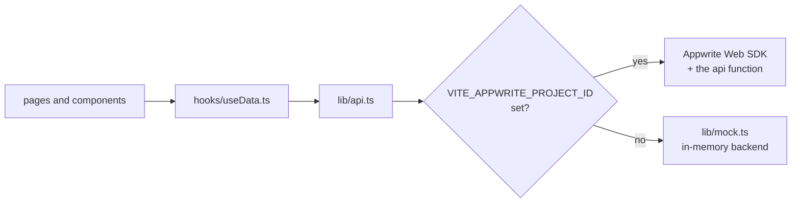
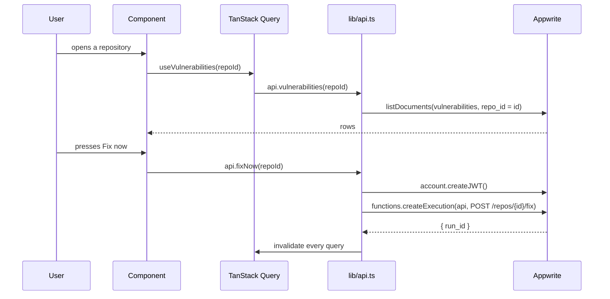

# Dashboard

A Vite + React + TypeScript single-page app. Reads TablesDB directly through
the Appwrite Web SDK, writes through the `api` function, and updates itself
through Realtime.

- [Running it](#running-it)
- [Demo mode](#demo-mode)
- [Pages](#pages)
- [How data flows](#how-data-flows)
- [Live updates](#live-updates)
- [Design](#design)
- [Testing](#testing)

## Running it

```bash
make demo     # dev server on http://localhost:5173
make build-ui # production build into apps/dashboard/dist
make test-ui  # 16 tests
```

The build is about 246 KB, 79 KB gzipped. Any static host will serve it;
Appwrite Sites is optional.

## Demo mode

With `VITE_APPWRITE_PROJECT_ID` empty, the whole app runs against an in-memory
backend instead of Appwrite. This is not a mock layer bolted onto the tests: it
is a second implementation of the same `api` surface, so every page, hook and
component behaves exactly as it does against a real project.



Pressing **Fix now** in demo mode plays a scripted run over about 17 seconds:

| At | State | Event |
|---|---|---|
| 0.0s | `QUEUED` | Run queued (manual) |
| 1.2s | `PLANNING` | Selected 4 vulnerabilities to fix |
| 2.6s | `PATCHING` | Planned 4 changes |
| 4.2s | `PR_OPEN` | Committed to `vulnagent/run-8f21` |
| 5.4s | `AWAITING_CI` | Opened pull request #42 |
| 8.2s | `REPAIRING` | CI failed: `TypeError: jwt.sign is not a function` |
| 9.4s | `REPAIRING` | Memory hit at 0.93 similarity |
| 11.0s | `AWAITING_CI` | Patch pushed, attempt 1 |
| 14.5s | `READY_TO_MERGE` | CI passed |
| 16.0s | `MERGED` | Pull request #42 merged |
| 17.2s | `COMPLETED` | 4 vulnerabilities marked fixed |

The counts drop to zero and the repository returns to Sleeping 😴, which is the
full §1 flow from the specification without a single credential.

A "demo data" badge sits in the header so nobody mistakes it for real state.

## Pages

### `/login`

Sign in with GitHub through Appwrite OAuth. In demo mode it is skipped
entirely.

### `/` — repositories overview

```
┌────────────────────────────────────────────────────────────────┐
│  Open vulnerabilities                    [Install GitHub App]  │
│  Across 4 linked repositories                                  │
├────────┬────────┬────────┬────────┬────────┐                   │
│   1    │   3    │   3    │   3    │   3    │  ← totals          │
│CRITICAL│  HIGH  │ MEDIUM │  LOW   │UNKNOWN │                   │
├────────┴────────┴────────┴────────┴────────┴───────────────────┤
│ Repository            Open              Agent      Last scan   │
│ pranav/vulnagent-...  1 critical 2 high  Sleeping 😴  12m ago   │
│   npm                                        [Scan now][Fix now]│
│ pranav/checkout-api   2 medium 3 low     Sleeping 😴  2h ago    │
├────────────────────────────────────────────────────────────────┤
│ Not configured                                                 │
│ pranav/docs-site       Add a .vulnagent.yml  [Copy sample config]│
└────────────────────────────────────────────────────────────────┘
```

Unconfigured repositories are separated out rather than listed with zero
counts, because "nothing found" and "never looked" are different states. The
copy button puts a working starter config on the clipboard.

*Fix now* is disabled when a run is already active or there is nothing open.

### `/repos/:id` — repository detail

Three sections:

**Agent panel.** A step indicator (Planning → Pull request → CI → Repair →
Merge) with the current step highlighted, the repair count as `n/max`, a link
to the PR, and the live event timeline. `memory_hit` rows are tinted amber,
failures red, successes green.

**Vulnerabilities table.** Advisory id linking to osv.dev, CVE aliases, package
name, installed → fixed versions in monospace, severity badge, and a status
that spells itself out: "being fixed", "no fix available", "needs a major
bump". Filters across the top: open, all, or one severity.

Clicking **transitive** on a finding expands its dependency path:

```
your package.json  →  express@4.16.0  →  qs@6.5.2
```

That comes from walking `dependency_edges` back to `ROOT`, which answers the
question every transitive finding raises: why is this even installed.

**Past runs.** Each with its outcome, trigger and PR link.

### `/setup`

Where the GitHub App's setup URL returns. Links the installation to the
signed-in user and redirects to the overview.

## How data flows



Reads go straight to TablesDB, because Appwrite's row permissions already
restrict them to the signed-in user's repositories. Writes go through the
`api` function, which holds the server key and re-checks ownership.

## Live updates

One subscription for the whole app:

```typescript
client.subscribe([
  'databases.vulnagent.tables.repos.rows',
  'databases.vulnagent.tables.vulnerabilities.rows',
  'databases.vulnagent.tables.agent_events.rows',
  'databases.vulnagent.tables.agent_runs.rows',
], () => queryClient.invalidateQueries())
```

Any change invalidates everything and TanStack Query refetches what is
mounted. Coarse, and the right trade at this size: the alternative is mapping
each event type to the queries it affects, which is more code and more ways to
be subtly stale. The payload is small and the user is usually looking at one
repository.

In demo mode the same call subscribes to the in-memory backend's own listener
set, so the timeline animates identically.

## Design

Dark by default, per §14.3. The palette is defined once as Tailwind v4 theme
tokens in `index.css`:

| Token | Use |
|---|---|
| `ink-950` … `ink-50` | Backgrounds through to primary text |
| `critical` `#f0556d` | Critical severity |
| `high` `#f58a42` | High |
| `medium` `#e0b341` | Medium, and memory hits |
| `low` `#7f93b8` | Low |
| `unknown` `#5b6478` | Unscored |
| `accent` `#6ba8ff` | Interactive, agent activity |
| `good` `#4fc08d` | Success |

Package names and versions are monospace, because they are identifiers and
proportional type makes `4.17.20` and `4.17.2` harder to tell apart than they
should be.

Two small animations earn their place: a pulsing ring on the agent dot while a
run is active, and a short slide-in on new timeline rows so an event arriving
over Realtime is noticed rather than silently appearing.

Severity is never encoded by color alone; every badge carries its label.

## Testing

16 tests in `src/test/App.test.tsx`, run with Vitest and Testing Library
against jsdom. They drive the real `App` through the real `api`, in demo mode,
so what they exercise is the same wiring a live project uses.

Coverage: the overview list and totals, severity breakdowns, the sleeping
state, the unconfigured section, the demo badge, the vulnerability table, the
dependency path expansion, the unfixable label, and the *Fix now* flow from
both pages.

Two isolation details, both learned the hard way:

- With `globals: false`, Testing Library does not register its own cleanup, so
  `src/test/setup.ts` calls `cleanup()` after each test. Without it, renders
  stack up in one document and queries start matching leftovers.
- The demo backend is a module singleton, so the same file also calls
  `mockBackend.reset()`, clearing its timers and state. Otherwise a run started
  by one test leaves the repository `working` for the next.
