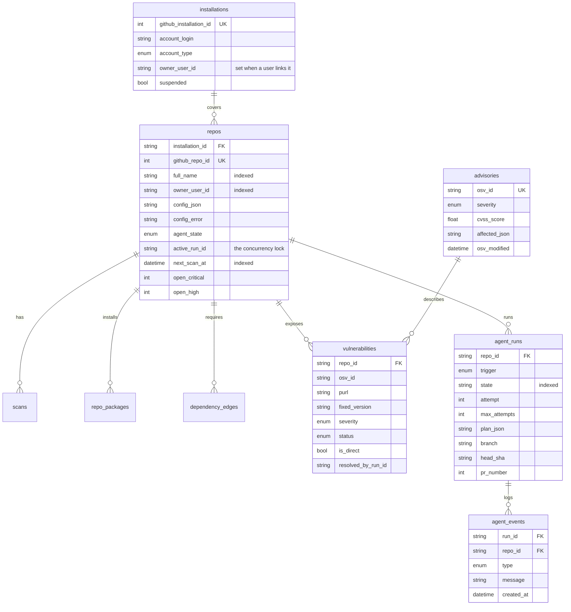
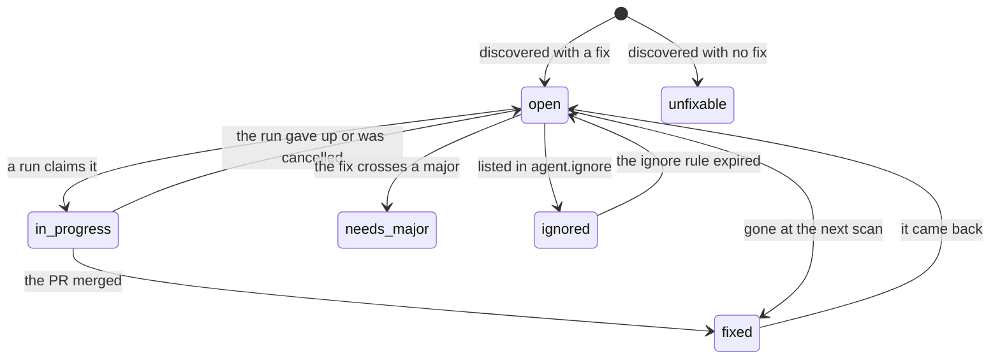

# Data model

Ten tables in Appwrite TablesDB plus one VectorsDB collection. Created by
`make bootstrap`, which is idempotent: it adds what is missing and leaves what
exists alone.

- [Overview](#overview)
- [Lifecycles](#lifecycles)
- [Tables](#tables)
- [The vector collection](#the-vector-collection)
- [Access and permissions](#access-and-permissions)
- [Working with rows in code](#working-with-rows-in-code)

## Overview



## Lifecycles

Not every table behaves the same way, and the differences matter more than the
column lists.

| Table | Lifecycle | Written by |
|---|---|---|
| `installations` | Upserted on webhook, deleted on uninstall | `github_webhook` |
| `repos` | Upserted on webhook, updated constantly | webhook, scan, agent |
| `scans` | Append-only audit record | `scan_repo` |
| `repo_packages` | **Snapshot**, deleted and rewritten each scan | `scan_repo` |
| `dependency_edges` | **Snapshot**, deleted and rewritten each scan | `scan_repo` |
| `advisories` | **Global cache**, shared across repositories | `scan_repo` |
| `vulnerabilities` | **Reconciled**, status carries meaning over time | scan, agent |
| `agent_runs` | One per run, state mutates until terminal | `agent_step` |
| `agent_events` | Append-only timeline | `agent_step` |
| `webhook_deliveries` | Append-only dedupe ledger | `github_webhook` |

The snapshot tables are rewritten rather than merged because a merge leaves
behind packages the project removed. The reconciled table is the opposite: its
history is the point, so a row's `status`, `first_seen_at` and
`resolved_by_run_id` survive across scans.

## Tables

### `installations`

One row per GitHub App installation.

| Column | Type | Notes |
|---|---|---|
| `github_installation_id` | integer | unique index |
| `account_login` | string | the org or user the app is installed on |
| `account_type` | enum | `User` / `Organization` |
| `owner_user_id` | string, nullable | the Appwrite user, once linked |
| `suspended` | boolean | GitHub can suspend an installation |

`owner_user_id` is null until someone completes the setup flow. Until then the
repositories exist but no dashboard user can see them.

### `repos`

The central table. Carries configuration, agent state and denormalised counts.

| Column | Type | Notes |
|---|---|---|
| `installation_id` | string | the Appwrite row id, not GitHub's |
| `github_repo_id` | integer | unique index |
| `full_name` | string | index; `owner/name` |
| `default_branch` | string | read from GitHub, never assumed to be `main` |
| `owner_user_id` | string, nullable | index; drives dashboard visibility |
| `has_config` | boolean | whether a `.vulnagent.*` file exists |
| `config_json` | long string | the raw file, stored verbatim |
| `config_error` | string, nullable | a parse failure, shown on the dashboard |
| `ecosystems` | string[] | what the last scan detected |
| `agent_state` | enum | `idle` / `scanning` / `working` / `error` |
| `active_run_id` | string, nullable | at most one active run |
| `next_scan_at` | datetime, nullable | index; null means never scheduled |
| `last_scan_at` | datetime, nullable | |
| `open_critical` … `open_unknown` | integer | five denormalised counters |

The raw config is stored rather than the parsed result, so a config that was
valid when written still shows its original text after the schema changes.

### `scans`

| Column | Type | Notes |
|---|---|---|
| `repo_id` | string | index |
| `trigger` | enum | `schedule` / `push` / `new_advisory` / `manual` |
| `status` | enum | `running` / `succeeded` / `failed` |
| `commit_sha` | string | what was scanned |
| `packages_scanned`, `vulns_found` | integer | |
| `error` | string, nullable | the failure, truncated to 500 characters |
| `started_at`, `finished_at` | datetime | |

A failed scan is still recorded, with its error, which is how you find out that
a repository has been silently failing to scan for a week.

### `repo_packages`

| Column | Type | Notes |
|---|---|---|
| `repo_id` | string | |
| `purl` | string | unique index on `(repo_id, purl)` |
| `ecosystem`, `name`, `version` | string | `name` is indexed |
| `is_direct`, `is_dev` | boolean | |
| `scan_id` | string | which scan produced this row |

### `dependency_edges`

| Column | Type | Notes |
|---|---|---|
| `repo_id` | string | index |
| `parent_purl` | string | the literal `ROOT` for direct dependencies |
| `child_purl` | string | index on `(repo_id, child_purl)` |
| `requested_range` | string | the range the parent declared |
| `ecosystem`, `scan_id` | string | |

Walking `child_purl` back to `ROOT` is what produces the dependency path the
dashboard shows for a transitive finding.

### `advisories`

The OSV cache, global rather than per repository.

| Column | Type | Notes |
|---|---|---|
| `osv_id` | string | unique index |
| `aliases` | string[] | CVE ids and others |
| `summary` | string | one line |
| `details` | long string | the full description |
| `severity` | enum | banded by `osv/severity.py` |
| `cvss_score` | float, nullable | the numeric base score |
| `affected_json` | long string | the raw `affected` section |
| `osv_modified` | datetime | for a future refresh pass |

`affected_json` is kept raw because planning re-reads it to extract fixed
versions for a specific package and ecosystem, and normalising it at write time
would throw away what a later question needs.

### `vulnerabilities`

One row per `(repo, advisory, package version)`.

| Column | Type | Notes |
|---|---|---|
| `repo_id` | string | index |
| `osv_id`, `purl` | string | unique index on `(repo_id, osv_id, purl)` |
| `package_name`, `installed_version` | string | denormalised for display |
| `fixed_version` | string, nullable | null means nothing to act on |
| `severity` | enum | index on `(repo_id, status, severity)` |
| `status` | enum | see below |
| `is_direct` | boolean | |
| `first_seen_at`, `last_seen_at` | datetime | |
| `resolved_at`, `resolved_by_run_id` | nullable | which run fixed it |



### `agent_runs`

| Column | Type | Notes |
|---|---|---|
| `repo_id` | string | index |
| `trigger` | enum | `auto` / `manual` |
| `state` | string | index; the agent state machine |
| `attempt`, `max_attempts` | integer | the CI repair budget |
| `vuln_ids` | string[] | what this run claimed |
| `plan_json` | long string | the serialised `UpgradePlan` |
| `branch` | string, nullable | `vulnagent/{run id}` |
| `base_sha`, `head_sha` | string, nullable | what it branched from, where it is |
| `pr_number`, `pr_url` | nullable | |
| `last_error` | string, nullable | |
| `created_at`, `updated_at`, `completed_at` | datetime | |

`state` is a plain string rather than an enum because the state machine owns
the vocabulary, and a schema migration every time a state is added would be a
poor trade.

### `agent_events`

| Column | Type | Notes |
|---|---|---|
| `run_id`, `repo_id` | string | both indexed |
| `type` | enum | ten types, see [the agent](agent.md#the-timeline) |
| `message` | string | human-readable |
| `data_json` | string, nullable | structured extras |
| `created_at` | datetime | |

This is the Realtime source the dashboard subscribes to.

### `webhook_deliveries`

| Column | Type | Notes |
|---|---|---|
| `delivery_id` | string | unique index |
| `event` | string | |
| `received_at` | datetime | |

The row id is derived from GitHub's delivery UUID, sanitised to Appwrite's
allowed character set and 36-character limit. Insert-first, and a unique
violation means "already handled".

## The vector collection

Database `vulnagent_vectors`, collection `ci_failures`.

| Field | Type | Notes |
|---|---|---|
| `embedding` | vector(384) | width fixed by the model at creation |
| `ecosystem` | string | **always** filtered on |
| `error_signature` | string | the normalised failure |
| `log_excerpt` | string | capped at 4 KB |
| `package_changes` | string | `jsonwebtoken 8.5.1->9.0.2` |
| `fix_diff` | string | what turned CI green |
| `outcome` | enum | `success` / `failed` |
| `repo_full_name`, `run_id` | string | provenance |
| `created_at` | datetime | |

Indexed `hnsw_cosine` on `embedding`. See [Failure memory](memory.md).

## Access and permissions

| Table | Dashboard reads | Dashboard writes |
|---|---|---|
| `repos` | rows where `owner_user_id` matches | never |
| `vulnerabilities` | via its repo | never |
| `agent_runs`, `agent_events` | via its repo | never |
| `dependency_edges` | via its repo | never |
| everything else | no | never |

Every write goes through a function holding the server API key. The dashboard's
three actions, link, scan and fix, go through the `api` function, which
verifies the caller's JWT and checks `owner_user_id` before doing anything.

## Working with rows in code

Nothing outside `db/` and `memory/` makes a raw SDK call. The rest of the
codebase works with pydantic models from `db/rows.py` through typed
repositories:

```python
db = Database(TablesDB(client))

repo = db.repos.by_full_name("pranav/test-app")
open_vulns = db.vulnerabilities.open_for_repo(repo.id)
db.repos.set_counts(repo.id, {"critical": 1, "high": 2, ...})
db.repos.go_to_sleep(repo.id)
```

`Table[TRow]` provides `create`, `get`, `update`, `delete`, `find` and `first`,
with paging up to a 5000-row ceiling. Each table subclass adds the queries that
make sense for it. Appwrite's `$`-prefixed system fields never reach a domain
model, and datetimes are serialised on the way out and parsed on the way back.

Tests use `tests/fakes.py:FakeTablesDB`, an in-memory stand-in that understands
the query shapes the repositories actually send, so repository behavior is
tested without a live project.
