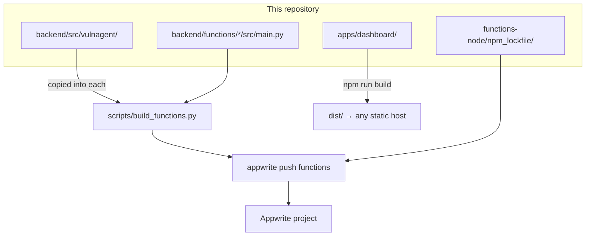
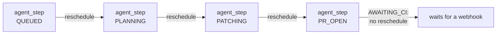

# Deployment

What runs where, how the Python package reaches each function, and what to
check after a deploy.

- [The shape of a deployment](#the-shape-of-a-deployment)
- [Why functions are vendored](#why-functions-are-vendored)
- [Function reference](#function-reference)
- [Deploying](#deploying)
- [The dashboard](#the-dashboard)
- [After the first deploy](#after-the-first-deploy)
- [Rollback](#rollback)

## The shape of a deployment



Seven functions: six Python, one Node. The dashboard is static files and does
not have to live on Appwrite at all.

## Why functions are vendored

Appwrite builds each function from its own folder. It cannot see the uv
workspace, so a function importing `vulnagent` would fail at build time.

`scripts/build_functions.py` copies `backend/src/vulnagent/` into each
function's `src/` directory before deploy:

```
backend/functions/scan_repo/
├── src/
│   ├── main.py              committed
│   └── vulnagent/           copied in, gitignored
└── requirements.txt         committed
```

The copies are in `.gitignore`, so the package has exactly one source of
truth. Re-run `make build-functions` after any change under
`backend/src/vulnagent/` or the deployed functions will carry stale code. The
`make deploy` target does it for you.

The alternative, publishing `vulnagent` to an index and installing it as a
dependency, would mean a release cycle for every change. Vendoring is the
cheaper trade at this size.

## Function reference

| Function | Runtime | Trigger | Timeout | Execute permission |
|---|---|---|---|---|
| `github_webhook` | python-3.12 | HTTP | 30s | `any` (GitHub is unauthenticated to Appwrite) |
| `scheduler` | python-3.12 | cron `*/15 * * * *` | 120s | none |
| `scan_repo` | python-3.12 | async execution | 900s | none |
| `agent_step` | python-3.12 | async execution | 900s | none |
| `on_vuln_created` | python-3.12 | row create on `vulnerabilities` | 30s | none |
| `api` | python-3.12 | HTTP | 30s | `users` |
| `npm_lockfile` | node-20 | sync execution | 300s | none |

"Execute permission: none" means only the server API key can invoke it, which
is what you want for everything the dashboard does not call directly.

### Why those timeouts

**30s on `github_webhook`** because GitHub retries a delivery that takes too
long. The function verifies, claims the delivery id, enqueues the real work and
returns. It must never do the work itself.

**900s on `scan_repo`** because a large repository is thousands of packages,
several OSV batches, and an advisory fetch for each one not already cached.
The first scan of a big repo is the slow one; later scans mostly hit the
cache.

**900s on `agent_step`** because the repair step downloads logs, calls a model
and commits. One transition, but a slow one.

**300s on `npm_lockfile`** because `npm install --package-lock-only` has to
resolve the whole tree against the registry. The function sets its own 120s
cap on the npm subprocess, inside the platform's limit.

### Chaining

`agent_step` re-enqueues itself for states it can advance alone:



Each link is a separate execution with its own timeout, so a long run never
hits one. The payload carries `expected_state`, and an execution whose
expectation no longer matches the stored state exits without acting.

## Deploying

```bash
make deploy
```

Which is:

1. `make check` — lint, types, both test suites. A red build does not ship.
2. `make build-functions` — vendor the package into all six Python functions.
3. `appwrite push functions` — upload using `appwrite.config.json`.

`appwrite.config.json` carries each function's id, runtime, entrypoint, build
command, timeout, events and scopes. Fill in `projectId` before the first
push.

Environment variables are set per function in the Appwrite console, or with
`appwrite functions create-variable`. They are not in the config file, because
that file is committed.

| Function | Needs |
|---|---|
| `github_webhook` | Appwrite, GitHub, `SCAN_REPO_FUNCTION_ID`, `AGENT_STEP_FUNCTION_ID` |
| `scheduler` | Appwrite, `SCAN_REPO_FUNCTION_ID` |
| `scan_repo` | Appwrite, GitHub, `OSV_BASE_URL`, `AGENT_STEP_FUNCTION_ID` |
| `agent_step` | All of the above plus `LLM_*`, `EMBEDDING_*`, `NPM_LOCKFILE_FUNCTION_ID` |
| `on_vuln_created` | Appwrite, `AGENT_STEP_FUNCTION_ID` |
| `api` | Appwrite, `SCAN_REPO_FUNCTION_ID`, `AGENT_STEP_FUNCTION_ID` |
| `npm_lockfile` | none |

`agent_step` is the one that needs everything, because it is the only function
that talks to the model, the memory and the lockfile helper.

## The dashboard

```bash
make build-ui   # → apps/dashboard/dist
```

Static files. Three things to get right:

1. **The `VITE_*` variables are baked in at build time**, not read at runtime.
   Changing one means rebuilding.
2. **Only public values belong there.** No API key ever goes into a `VITE_`
   variable; the dashboard authenticates as the user, and privileged work
   happens in the `api` function.
3. **It needs SPA routing.** `/repos/:id` and `/setup` must serve
   `index.html`, or a refresh on a detail page 404s.

## After the first deploy

In order:

1. **Set the webhook URL.** The GitHub App needs `github_webhook`'s public
   domain, which does not exist until the first deploy. This is the one
   chicken-and-egg in the setup.
2. **Install the app on a repository.** Check that `installations` and `repos`
   rows appear. If they do not, the problem is the webhook URL, the secret, or
   the event subscriptions.
3. **Check a delivery.** GitHub's app settings show every delivery with its
   response. A 401 means the secret does not match.
4. **Run a scan.** *Scan now* from the dashboard, then look for a `scans` row
   with `status: succeeded`.
5. **Check the function logs** in the Appwrite console for anything the
   scripts' probes swallowed.

[Troubleshooting](troubleshooting.md) covers what each failure looks like.

## Rollback

Appwrite keeps previous deployments and can activate an older one from the
console, which is the fastest way out of a bad push.

Two things that do not roll back with it:

- **Schema changes.** `bootstrap_db.py` only ever adds. A column a new version
  introduced stays behind, which is harmless; old code ignores it.
- **The vector collection's dimension.** Fixed at creation. Changing the
  embedding model means a new collection and a reseed.

To stop the agent without rolling anything back, set `enabled: false` in the
affected repository's `.vulnagent.yml`, or disable the `scheduler` function to
stop all scheduled work while leaving webhooks flowing.
