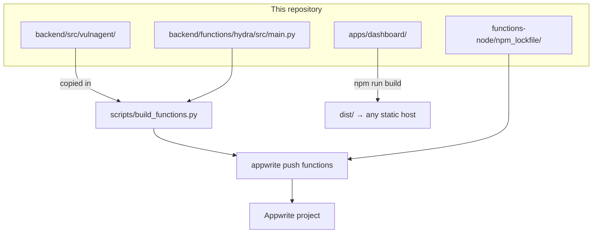
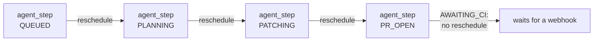

# Deployment

What runs where, how the Python package reaches each function, and what to
check after a deploy.

- [The shape of a deployment](#the-shape-of-a-deployment)
- [Why functions are vendored](#why-functions-are-vendored)
- [Function reference](#function-reference)
- [Deploying](#deploying)
- [The dashboard](#the-dashboard)
- [After the first deploy](#after-the-first-deploy)
- [Rollback](#rollback)

## The shape of a deployment



Two functions: `hydra` (Python) and `npm_lockfile` (Node). Appwrite's free plan
allows only two, so the six Python handlers share one function and a router
picks between them; see
[One function, six handlers](architecture.md#one-function-six-handlers). The
dashboard is static files and does not have to live on Appwrite at all.

## Why functions are vendored

Appwrite builds each function from its own folder. It cannot see the uv
workspace, so a function importing `vulnagent` would fail at build time.

`scripts/build_functions.py` copies `backend/src/vulnagent/` into the
function's `src/` directory before deploy. `main.py` only re-exports
`vulnagent.entrypoints.main.main`; the handlers live in the package:

```
backend/functions/hydra/
├── src/
│   ├── main.py              committed
│   └── vulnagent/           copied in, gitignored
└── requirements.txt         committed, pinned with ==
```

`requirements.txt` pins every package with `==` to the version in `uv.lock`,
and a test enforces it. Unpinned, Appwrite installed appwrite 27.1.0 while the
tests ran on 26.0.0.

The copies are in `.gitignore`, so the package has exactly one source of
truth. Re-run `make build-functions` after any change under
`backend/src/vulnagent/` or the deployed functions will carry stale code. The
`make deploy` target does it for you.

The alternative, publishing `vulnagent` to an index and installing it as a
dependency, would mean a release cycle for every change. Vendoring is the
cheaper trade at this size.

## Function reference

| Function | Runtime | Triggers | Timeout | Execute permission |
|---|---|---|---|---|
| `hydra` | python-3.12 | HTTP, 60-minute interval, row create on `vulnerabilities`, signed self-executions | 900s | `any` (GitHub is unauthenticated to Appwrite) |
| `npm_lockfile` | node-22 | sync execution | 300s | none |

"Execute permission: none" means only the server API key can invoke it.
`hydra` has to be `any`, which is why its internal task paths check an
HMAC signature instead of trusting the caller; see
[Why tasks are signed](architecture.md#why-tasks-are-signed). Dashboard calls
are authenticated by the user's JWT inside the `api` handler.

### Why those timeouts

A timeout is per function, so every `hydra` handler gets 900s. The slow
handlers set that number; the fast ones still return quickly.

**The `github_webhook` handler stays fast** because GitHub retries a delivery
that takes too long. It verifies, claims the delivery id, enqueues the real
work as a signed task and returns. It must never do the work itself.

**900s for `scan`** because a large repository is thousands of packages,
several OSV batches, and an advisory fetch for each one not already cached.
The first scan of a big repo is the slow one; later scans mostly hit the
cache.

**900s for `agent_step`** because the repair step downloads logs, calls a model
and commits. One transition, but a slow one.

**300s on `npm_lockfile`** because `npm install --package-lock-only` has to
resolve the whole tree against the registry. The function sets its own 120s
cap on the npm subprocess, inside the platform's limit.

### Chaining

`agent_step` re-enqueues itself for states it can advance alone:



Each link is a separate execution of `hydra` on `/tasks/agent-step`, with its
own timeout, so a long run never
hits one. The payload carries `expected_state`, and an execution whose
expectation no longer matches the stored state exits without acting.

## Deploying

```bash
make deploy
```

Which is:

1. `make check`: lint, types, both test suites. A red build does not ship.
2. `make build-functions`: vendor the package into `hydra`.
3. `appwrite push functions`: upload using `appwrite.config.json`.

`appwrite.config.json` carries each function's id, runtime, entrypoint, build
command, timeout and events. Fill in `projectId` before the first push.

The functions declare no scopes on purpose. Every one of them authenticates
with `APPWRITE_API_KEY`, never with the key Appwrite injects per execution,
so granting scopes would only hand out access nothing uses. A project also
refuses scopes its own keys do not hold, which fails the push with "An API
key cannot grant scopes it does not hold".

`appwrite.config.json` declares two functions. `hydra` has execute `["any"]`,
the event `databases.vulnagent.tables.vulnerabilities.rows.*.create`, the
`interval` 60 (no cron `schedule`), timeout 900 and scopes `[]`. `npm_lockfile` runs on
node-22 with timeout 300.

The scheduler runs on an interval rather than cron because Appwrite Cloud's
free plan no longer accepts cron schedules (the push fails with "Your current
plan doesn't support cron schedules"), and 60 minutes is the shortest interval
it allows. Interval runs still arrive with `x-appwrite-trigger: schedule`, so
routing is unaffected. The cost is latency: a repository is scanned up to an
hour after its `next_scan_at`. On a paid plan, a shorter `interval` works with
no code change.

Environment variables are set per function in the Appwrite console, or with
`appwrite functions create-variable`. They are not in the config file, because
that file is committed.

| Function | Needs |
|---|---|
| `hydra` | Every server variable in [Configuration](configuration.md#environment-variables) (Appwrite, GitHub, `OSV_BASE_URL`, `LLM_*`, `EMBEDDING_*`) plus `NPM_LOCKFILE_FUNCTION_ID`. Not the `VITE_*` ones |
| `npm_lockfile` | none |

One function runs every handler, so it needs the union of what they need.
`APPWRITE_API_KEY` doubles as the task signing key: without it every internal
task is refused with 403. `APPWRITE_FUNCTION_ID` is injected by Appwrite and
names the function tasks are sent to.

## The dashboard

```bash
make build-ui   # → apps/dashboard/dist
```

Static files. Three things to get right:

1. **The `VITE_*` variables are baked in at build time**, not read at runtime.
   Changing one means rebuilding.
2. **Only public values belong there.** No API key ever goes into a `VITE_`
   variable; the dashboard authenticates as the user, and privileged work
   happens in the `api` handler of `hydra`. `VITE_API_FUNCTION_ID` is
   `hydra`.
3. **It needs SPA routing.** `/repos/:id` and `/setup` must serve
   `index.html`, or a refresh on a detail page 404s.

## After the first deploy

In order:

1. **Set the webhook URL.** The GitHub App needs `hydra`'s public
   domain, which does not exist until the first deploy. This is the one
   chicken-and-egg in the setup.
2. **Install the app on a repository.** Check that `installations` and `repos`
   rows appear. If they do not, the problem is the webhook URL, the secret, or
   the event subscriptions.
3. **Check a delivery.** GitHub's app settings show every delivery with its
   response. A 401 means the secret does not match.
4. **Run a scan.** *Scan now* from the dashboard, then look for a `scans` row
   with `status: succeeded`.
5. **Check the function logs** in the Appwrite console for anything the
   scripts' probes swallowed.

[Troubleshooting](troubleshooting.md) covers what each failure looks like.

## Rollback

Appwrite keeps previous deployments and can activate an older one from the
console, which is the fastest way out of a bad push.

Two things that do not roll back with it:

- **Schema changes.** `bootstrap_db.py` only ever adds. A column a new version
  introduced stays behind, which is harmless; old code ignores it.
- **The vector collection's dimension.** Fixed at creation. Changing the
  embedding model means a new collection and a reseed.

To stop the agent without rolling anything back, set `enabled: false` in the
affected repository's `.vulnagent.yml`. The scheduler is no longer a separate
function, so there is no switch that stops only scheduled work: disabling
`hydra` stops webhooks, the dashboard and tasks too.
