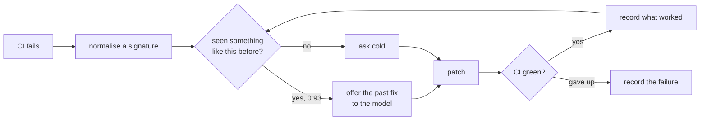
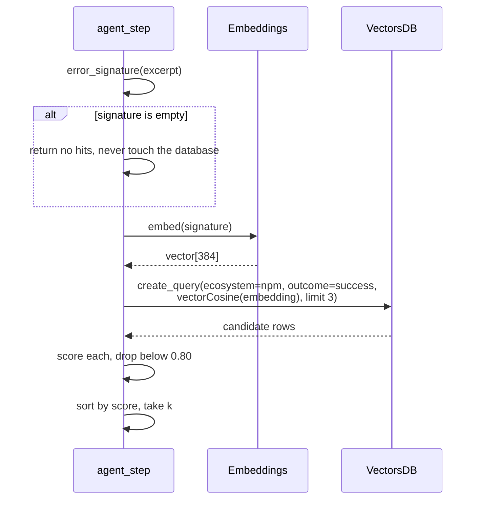
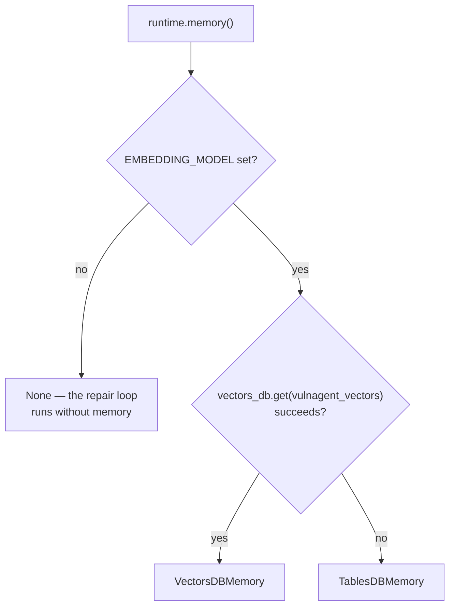

# Failure memory

The part of the system that gets better with use. When CI breaks on an
upgrade, the agent asks whether it has seen this failure before and what fixed
it last time.

- [Why it exists](#why-it-exists)
- [What a memory is](#what-a-memory-is)
- [Writing](#writing)
- [Reading](#reading)
- [Embeddings](#embeddings)
- [Two implementations](#two-implementations)
- [Seeding](#seeding)
- [Tuning](#tuning)

## Why it exists

Dependency upgrades break in repetitive ways. `jsonwebtoken` 8 to 9 removes
the callable default export, and every project that upgrades hits the same
`TypeError` and needs the same shape of fix. A model asked cold will often work
it out; a model handed the fix that worked last time will work it out faster,
more cheaply, and more consistently.



## What a memory is

```python
class FailureRecord(BaseModel):
    ecosystem: str          # always filtered on
    error_signature: str    # normalised, stable across runs
    log_excerpt: str        # capped at 4 KB
    package_changes: str    # "jsonwebtoken 8.5.1->9.0.2"
    fix_diff: str           # what turned CI green
    outcome: Outcome        # success | failed
    repo_full_name: str
    run_id: str
    created_at: datetime
```

The text that gets embedded is deliberately narrow:

```python
def embedding_text(self) -> str:
    return f"{self.error_signature}\n{self.package_changes}"
```

Not the whole log. A log carries run-specific noise that pushes two instances
of the same failure apart in vector space, which is exactly what the signature
normalisation exists to prevent. The package change is included because
"TypeError in a jsonwebtoken upgrade" and "TypeError in a lodash upgrade" are
different problems even when the error line is similar.

## Writing

Memories are written at two moments, both terminal:

| Moment | Outcome | Condition |
|---|---|---|
| A run completes after at least one repair | `success` | `attempt > 0` |
| A run gives up | `failed` | `attempt > 0` |

A run that never needed a repair writes nothing. There is no lesson in "the
upgrade worked first time", and recording it would dilute the store.

## Reading

```python
memory.search(signature, ecosystem="npm", k=3)
```



Three filters, each doing real work:

- **`ecosystem`** — a Python fix is noise when repairing an npm upgrade
- **`outcome = success`** — failures are recorded for analysis, never offered
  as suggestions
- **similarity ≥ 0.80** — a weak match is worse than no match, because it
  spends prompt budget pointing the model at the wrong thing

Appwrite's `Query.vector_cosine` ranks but does not filter by distance; its
`distance_less_than` is a geospatial query measured in metres, not a vector
one. So the threshold is applied to the rows that come back. Different Appwrite
versions report the score under different keys, so `_score_of` checks several
and falls back to recomputing cosine locally from the stored embedding.

Each surviving hit writes a `memory_hit` event, which is why the dashboard can
highlight the moment the agent recognised something.

## Embeddings

Appwrite provides embeddings itself, which settled an open question in the
spec: no third-party embedding key is needed.

| Model | Dimensions |
|---|---|
| `all-minilm` | 384 (default) |
| `nomic-embed-text` | 768 |

`all-minilm` is the default because error signatures are short, mostly
technical strings where the larger model buys little, and a narrower vector
keeps the column smaller.

The dimension is **fixed when the collection is created** and cannot be changed
afterwards. `AppwriteEmbeddings` knows each model's width and refuses a vector
of the wrong size rather than writing a row the collection will reject:

```
ConfigError: model 'all-minilm' returned 100 dimensions, expected 384
```

Changing models means recreating the collection and reseeding.

## Two implementations

Both satisfy the same protocol, so nothing above `memory/` knows which is in
use:

```python
class FailureMemory(Protocol):
    def add(self, record: FailureRecord) -> None: ...
    def search(self, signature: str, *, ecosystem: str, k: int = 3) -> list[Hit]: ...
```

### `VectorsDBMemory`

The real one. `create_document` to write, `create_query` with
`Query.vector_cosine` to read, HNSW cosine index on the embedding column.

### `TablesDBMemory`

The fallback, for the case where VectorsDB needs a dedicated database the
project does not have. Embeddings are stored as JSON text in an ordinary
column, and search is brute-force cosine over the rows for one ecosystem,
capped at 1000 rows.

Pure Python rather than numpy: at this scale a comprehension is fast enough,
and it keeps a large wheel out of every vendored function bundle.



The choice is made per execution, so creating the vectors database later
switches the agent over with no code change and no redeploy.

## Seeding

`make seed` writes six npm failure-to-fix pairs. Three cover
`jsonwebtoken` 8 to 9 from different angles, the runtime `TypeError`, the
eager secret validation, and the TypeScript arity error, because that is the
breaking change the end-to-end test repository is built around. The first real
run should get a hit rather than starting cold.

The seeds go through the same `error_signature` normalisation as a live
failure. A seed written in raw log form would never match anything.

## Tuning

| Knob | Where | Default | Effect of changing it |
|---|---|---|---|
| Similarity threshold | `memory/base.py:DEFAULT_THRESHOLD` | `0.80` | Lower admits weaker matches; higher means more cold starts |
| Top k | `memory/base.py:DEFAULT_TOP_K` | `3` | More hits mean a longer prompt |
| Embedded text | `FailureRecord.embedding_text` | signature + changes | Adding the log makes matching noisier |
| Model | `EMBEDDING_MODEL` | `all-minilm` | Requires recreating the collection |
| Rows scanned (fallback only) | `memory/tables.py:MAX_ROWS_SCANNED` | `1000` | Higher is slower and more complete |

The threshold is the one worth revisiting with real data. It was chosen from
the spec and has not yet been validated against a corpus of actual failures,
which is the kind of thing worth measuring once the store has a few hundred
rows in it.
