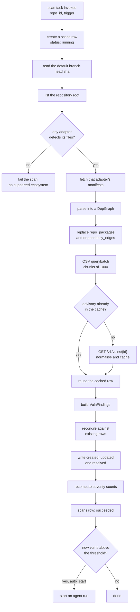
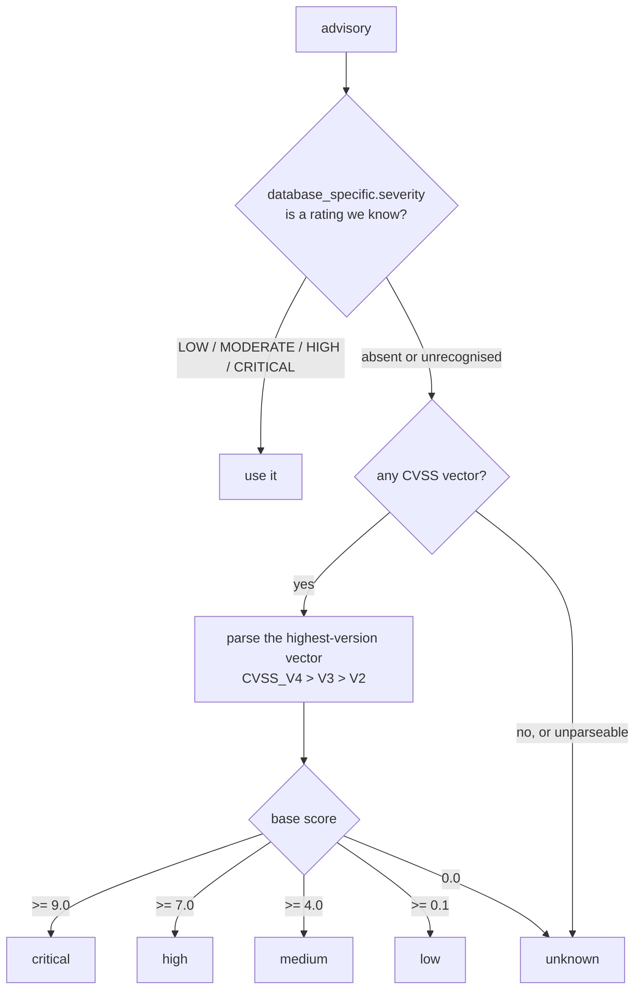
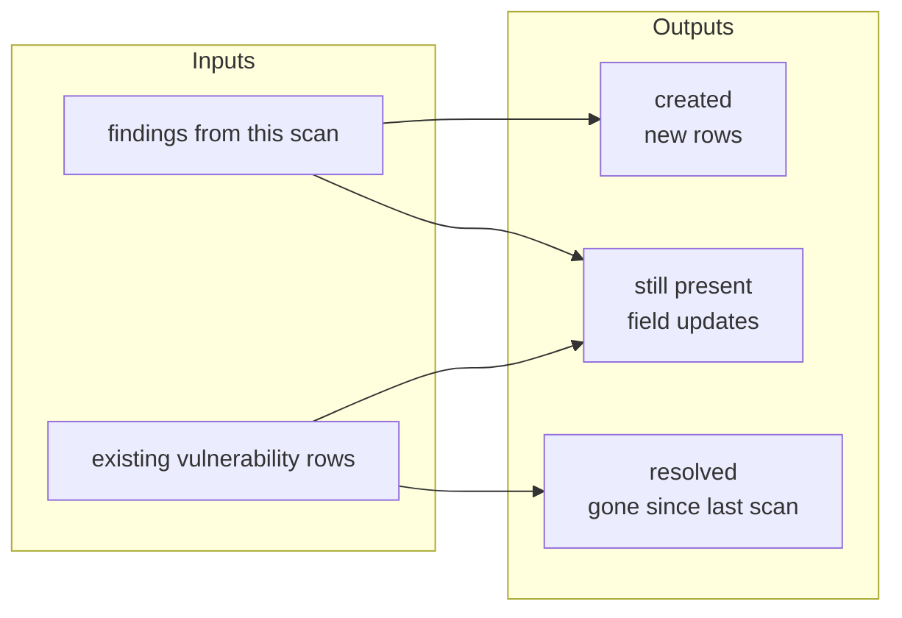

# Scanning

A scan answers one question: which advisories affect the versions this
repository actually installs right now. Everything downstream, the counts on
the dashboard and the work the agent picks up, comes from its output.

- [The pipeline](#the-pipeline)
- [Building the dependency graph](#building-the-dependency-graph)
- [Asking OSV](#asking-osv)
- [Severity](#severity)
- [Fixed versions](#fixed-versions)
- [Reconciliation](#reconciliation)
- [Counts](#counts)
- [Triggers](#triggers)
- [Cost and rate limits](#cost-and-rate-limits)

## The pipeline



Implemented in `scanning/scan.py`. The pure part, deciding what changed, is
`scanning/reconcile.py` and is tested without any network or database.

## Building the dependency graph

The scanner never parses a manifest itself. It calls
`adapter.parse_dependencies(files)` and gets back a `DepGraph`:

```python
class DepGraph(BaseModel):
    ecosystem: str
    nodes: dict[Purl, DepNode]   # every installed package
    edges: list[DepEdge]         # who requires whom, and with what range
```

A `DepEdge` whose parent is the literal string `ROOT` is a direct dependency of
the repository itself. Everything else is transitive, and following the edges
backwards is what lets the dashboard answer "why is this installed".

For npm specifically, see [Upgrade planning](upgrade-planning.md#parsing-the-lockfile);
the lockfile's install paths encode the tree, and resolution replays Node's
own lookup rules.

Both `repo_packages` and `dependency_edges` are a **snapshot**. Every scan
deletes the previous rows and writes fresh ones rather than merging, because a
merge would leave behind packages that were removed from the project.

## Asking OSV

One `POST /v1/querybatch` carries up to 1000 package queries:

```json
{
  "queries": [
    { "package": { "name": "lodash", "ecosystem": "npm" }, "version": "4.17.20" },
    { "package": { "name": "qs", "ecosystem": "npm" }, "version": "6.5.2" }
  ]
}
```

The response is positional: `results[i]` belongs to `queries[i]`. It carries
only advisory ids, so the full record comes from `GET /v1/vulns/{id}` and is
cached in `advisories`, keyed by OSV id and shared across every repository. A
second repo with the same vulnerable `lodash` costs no extra fetch.

`OsvClient` tolerates the shapes the API actually produces: a result with no
`vulns` key at all, a results array shorter than the query list, and a 404 on a
withdrawn advisory (which reads as `None`, not an exception).

## Severity

OSV records carry severity in more than one way, so `osv/severity.py` tries
them in order:



GitHub's `MODERATE` maps to `medium`. A malformed vector is never fatal: an
advisory nobody can score still has to reach the dashboard, so it lands on
`unknown`.

A 0.0 base score reads as `unknown` rather than `low`, because a vector that
scores zero is telling you it has no information, not that the problem is mild.

`unknown` ranks alongside `low` for threshold comparisons, so an unscored
advisory is picked up only by a repository that asked for everything. Rationale
in [DECISIONS.md](DECISIONS.md).

## Fixed versions

From `affected[].ranges[].events[].fixed`, filtered to the matching package and
ecosystem. Three details matter:

- **Only version-typed ranges count.** A `GIT` range's "fixed" value is a commit
  hash, not something you can put in a manifest.
- **`last_affected` is not a fix.** It is an upper bound on what is broken, and
  treating it as a fix would upgrade to a version that is still vulnerable.
- **Sorting is by semver precedence, not alphabetical.** `1.10.0` is newer than
  `1.9.0`, which string sorting gets backwards.

The ecosystem match is case-insensitive (`NPM` and `npm`), but the package name
match is exact, including the scope: `@babel/traverse` never matches
`traverse`.

## Reconciliation

Given what the scan found and what is already recorded, three sets come out:



Rows are keyed by `(osv_id, purl)`, so the same advisory affecting two versions
of a package is two rows, and upgrading one of them resolves only that one.

The rules that keep it from fighting the agent:

| Situation | What happens | Why |
|---|---|---|
| Found, never seen before | Created `open` | The normal case |
| Found, has a fix | `fixed_version` recorded | Planning needs it |
| Found, no fix anywhere | Created `unfixable` | Visible, but nothing to act on |
| Found, already `in_progress` | Status left alone | A run has claimed it; do not reopen it mid-flight |
| Found, already `ignored` | Status left alone | A deliberate decision outranks a scan |
| Found, newly in the ignore list | Becomes `ignored` | The config changed |
| Found, severity reassessed | Severity updated | Advisories get rescored |
| Not found, was `open` | Resolved `fixed` | Someone upgraded it |
| Not found, was `fixed` | Nothing | Already done |
| Not found, was `ignored` | Nothing | Still a deliberate decision |

`first_seen_at` is written once and never touched again; `last_seen_at` moves
forward on every scan that still sees it.

## Counts

`severity_counts` walks the rows and counts only `open` and `in_progress`,
which is why a repository being actively worked on still shows its outstanding
total rather than dropping to zero the moment a run starts. The five counters
are denormalised onto `repos` so the overview page needs one query, not one per
repository.

## Triggers

| Trigger | Condition |
|---|---|
| `schedule` | `scheduler` finds `next_scan_at <= now` and the repo is `idle` |
| `push` | A push to the default branch touched a manifest, and `scan.on_push` |
| `manual` | *Scan now* in the dashboard |
| `new_advisory` | Not a scan; a new row waking the agent directly |

A push that only changes source files queues nothing. `touches_a_manifest` asks
every registered adapter whether a path is one of its manifests, so a
`node_modules/lodash/package.json` in a diff does not count.

After a scheduled scan the next `next_scan_at` is computed with `croniter` from
`scan.schedule`. A `null` schedule means the repository is never due again, and
only a push or a human will scan it.

## Cost and rate limits

| Call | Volume per scan | Notes |
|---|---|---|
| GitHub contents | 1 + one per manifest | Three requests for a typical npm repo |
| OSV querybatch | `ceil(packages / 1000)` | Most repos are one request |
| OSV vulns | One per advisory **not already cached** | Drops to zero on repeat scans |
| npm registry | None during scanning | Only planning touches the registry |

OSV has no authentication and no documented hard rate limit, but the advisory
cache exists so a fleet of repositories sharing dependencies does not refetch
the same records. The spec's advisory-refresh pass, re-reading records whose
OSV `modified` timestamp moved, is on the cut list and not yet built.
