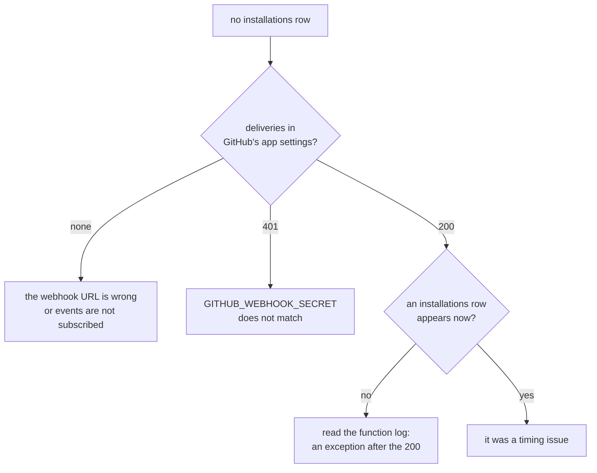
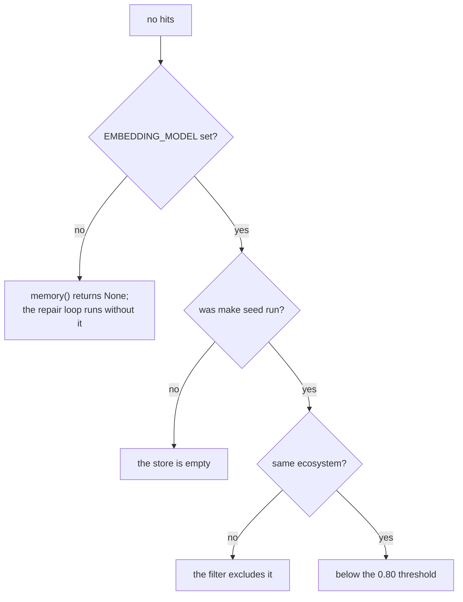

# Troubleshooting

Symptoms, likely causes, and how to check. Ordered roughly by when you will
hit them.

- [First run](#first-run)
- [Installation and webhooks](#installation-and-webhooks)
- [Scanning](#scanning)
- [The agent](#the-agent)
- [CI repair](#ci-repair)
- [Memory](#memory)
- [Dashboard](#dashboard)
- [Development](#development)
- [Reading the trail](#reading-the-trail)

## First run

Two things in this project have never executed against real infrastructure.
Expect friction there first.

### "Project is not accessible in this region"

`APPWRITE_ENDPOINT` is the generic `https://cloud.appwrite.io/v1` but the
project is regional. Copy the endpoint from the project's Settings page into
`APPWRITE_ENDPOINT` and `VITE_APPWRITE_ENDPOINT`. See [Setup](setup.md#1-appwrite-project).

### Rows are written but never read back

The Appwrite server SDK returns pydantic models with a row's columns nested
under `data`, not the plain JSON the service sends. Everything that reads a
response passes it through `vulnagent.db.responses.plain` first. A new read
that skips it sees nothing, without an error. The test fakes return the
SDK's own models, so the suite catches this.

### `bootstrap_vectors.py` exits 2

VectorsDB needs a dedicated database on your Appwrite plan. The script says so
rather than failing obscurely.

Three ways forward:

| Option | Trade |
|---|---|
| Self-host Appwrite with Docker | Full control, you run it |
| Pay for one dedicated database | Simplest, costs money |
| Do nothing | `TablesDBMemory` takes over automatically |

The fallback needs no code change and no redeploy: `runtime.memory()` probes
for the vectors database on every execution and picks the other implementation
when it is absent. Brute-force cosine over a few hundred rows is fine.

### `npm_lockfile` times out or cannot reach the registry

The first real test of spike B. Check, in order:

1. Can the function reach the network at all? Add a log line before the npm
   call and check the execution log.
2. Is 300 seconds enough? A cold npm with a large tree can be slow. The
   function's own subprocess cap is 120s; raise both if needed.
3. Does `npm` exist in the runtime at all? The node-22 runtime should ship it;
   log `npm --version` if in doubt.

If it cannot work, the spec's fallback is a Docker worker with Python and Node
that polls for runs in `PATCHING`. It implements the same
`LockfileRegenerator` protocol, so only the wiring in `runtime.py` changes.

### Everything imports but nothing happens

Handlers hand work to each other as signed async executions of `hydra` on
`/tasks/scan` and `/tasks/agent-step`. When those tasks never run, check in
order:

1. **`APPWRITE_API_KEY` in `hydra`'s environment.** It is the task signing
   key. If it is empty, every task is refused, so scans and runs are queued
   but never execute.
2. **`hydra`'s executions log** in the Appwrite console. A task execution that
   returned 403 failed its `x-hydra-signature` check; one that raised shows the
   exception.

`make doctor` reports which variables are still empty locally.

## Installation and webhooks

### Installing the app creates no rows



GitHub's app settings page shows every delivery with its request, response and
a redeliver button. That page answers most webhook questions faster than any
log.

### Deliveries return 401

The secret differs. It has to match byte for byte between the GitHub App
settings and `GITHUB_WEBHOOK_SECRET`. A trailing newline from
`echo "secret" > file` is the classic cause.

### Deliveries return 200 but nothing changes

Either the event is one the agent ignores, which is correct behavior for most
events, or the delivery id was already claimed. A redelivery of a delivery
that was already processed returns 200 and does nothing, by design.

To reprocess, delete the row from `webhook_deliveries` and redeliver.

### A repository shows "config error"

The message on the dashboard is the parse failure. Common ones:

| Message | Cause |
|---|---|
| `enabeld: Extra inputs are not permitted` | A typo; unknown keys are rejected deliberately |
| `max_ci_retries: Input should be less than or equal to 5` | Over the hard ceiling |
| `schedule: not a valid cron expression` | Not five fields, or not valid cron |
| `paths: only paths: ["."] is supported` | Multi-path is a non-goal for now |
| `expected a mapping at the top level` | The file is a list, or empty-but-not-empty |

The agent stays paused for that repository until the file parses.

## Scanning

### "no supported ecosystem found in the repository root"

`detect` needs **both** `package.json` and `package-lock.json` at the root. A
repository with only a manifest, or with its lockfile gitignored, will not
scan. Yarn and pnpm lockfiles are not supported.

### `UnsupportedLockfileError: lockfileVersion 1`

npm 6 or older. Regenerate with npm 7+:

```bash
rm package-lock.json && npm install
```

### A scan finds nothing in a repository you know is vulnerable

In order:

1. Does the lockfile actually pin the old version? The scan reads the lockfile,
   not the manifest's ranges.
2. Does OSV agree? `curl -s https://api.osv.dev/v1/query -d
   '{"package":{"name":"lodash","ecosystem":"npm"},"version":"4.17.20"}'`
3. Is the advisory below `severity_threshold`? It would be recorded but not
   acted on. Check the `all` filter on the repository page.
4. Is it in `agent.ignore` with an unexpired rule?

### Counts look wrong

They count `open` and `in_progress`, not `fixed`, `ignored` or `unfixable`.
A repository with four unfixable findings shows zero, which is intentional:
the number means "work outstanding", not "advisories known".

## The agent

### Stuck in `working` with nothing happening

The run exists but nothing is advancing it. Look at the run's state:

| State | Means |
|---|---|
| `AWAITING_CI` | Waiting for a webhook that may never come |
| `READY_TO_MERGE` | Waiting for a human, if `auto_merge` is false |
| Anything else | An execution was lost |

For `AWAITING_CI`, check that the repository has a workflow that runs on
pull requests, and that `workflow_run` and `check_suite` are subscribed in the
app settings. A repository with no workflows at all is treated as passing.

For a lost execution, re-enqueue the `agent_step` task with
`{run_id, expected_state: <current state>}`, either through `TaskQueue` or as
an async execution of `hydra` on `/tasks/agent-step` with a valid
`x-hydra-signature`. It is idempotent.

To clear a stuck repository by hand, set `active_run_id` to null and
`agent_state` to `idle` on the repo row, and set the run to `CANCELLED`.

### "Agent already working"

`repos.active_run_id` is set. If no run is genuinely active, it was left behind
by a crash. Clear it as above.

### The agent opened a PR with nothing in it

It should not: both `PLANNING` and `PATCHING` end in `NOTHING_TO_DO` when
there is nothing to change. If you see one, the plan changed the manifest in a
way that produced no diff, which is a bug worth a test.

### A transitive fix bumped something unexpected

It bumped the parent that pulls the vulnerable package in, which is usually
the right fix and occasionally surprising. The PR body says which, and the
dependency path on the repository page shows why. If the parent bump is
unwanted, `allow_major_bumps: false` will keep it within a major, and an
`ignore` rule will stop the fix entirely.

## CI repair

### "CI failed with no readable log"

Logs could not be downloaded. Either they expired, GitHub keeps them for a
limited window, or the app lacks `Actions: read`.

### "the model's response was unusable"

Two parse failures in a row. The raw replies are not stored, which is a gap:
`DocumentsDB` for full LLM transcripts is on the stretch list. For now, raise
the function's log level and reproduce.

### "rejected an unsafe patch"

Working as designed. The timeline event names the rule. Most common:

| Reason | What the model tried |
|---|---|
| `package.json is a manifest the agent itself maintains` | Downgrade the dependency |
| `the replacement disables a check` | Add `.skip` or `@ts-ignore` |
| `the edit removes N test declaration(s)` | Delete the failing test |
| `changes N lines, more than the limit of 200` | Rewrite half the file |

This is a give-up, not a retry, and the reasoning is in [safety](safety.md).

### Repairs loop without converging

Each attempt is independent, and `PREVIOUS_ATTEMPTS` is currently always empty
in the prompt — the plumbing is there but nothing fills it. That is a real gap:
the model cannot see that it already tried something. Until it is filled, a
lower `max_ci_retries` wastes less on failures that will not converge.

## Memory

### No `memory_hit` ever appears



The threshold is the usual answer. It was taken from the spec and has not been
validated against real data; lowering it to 0.70 temporarily will tell you
whether matches exist but are being filtered out.

### `model returned N dimensions, expected 384`

`EMBEDDING_MODEL` does not match the collection's width. `all-minilm` is 384,
`nomic-embed-text` is 768. The dimension is fixed when the collection is
created, so switching models means recreating it and reseeding.

### Hits are irrelevant

The signature is matching on the wrong thing. Compare the stored
`error_signature` with the live one: if they differ by something that should
have been normalised, like a path shape the regexes miss, that is a
normalisation bug worth a test.

## Dashboard

### Shows "demo data" against a real project

`VITE_APPWRITE_PROJECT_ID` was empty at **build** time. Vite inlines these at
build, not runtime, so rebuild after setting it.

### Signed in but no repositories

`owner_user_id` is not set on the repo rows, which means the installation was
never linked. Visit `/setup?installation_id=<id>`, or reinstall the app so the
setup URL fires. Check that `installations.owner_user_id` is set.

### Nothing updates without a refresh

Realtime is not connected. Check the browser console for a websocket error,
and confirm the endpoint allows websockets. The data is still correct; it is
only the push that is missing.

### A 404 on refreshing `/repos/:id`

The static host is not configured for SPA routing. Every path must serve
`index.html`.

## Development

### `make check` fails on a clean checkout

`make install` first. The dependency sentinels mean `make check` does not
install anything itself.

### mypy complains about an Appwrite method

The SDK is untyped in places. The narrow `Protocol` slices in `db/` and
`memory/` exist for exactly this: declare the methods you call, not the whole
service.

### Dashboard tests fail with "found multiple elements"

Cleanup is not running. `src/test/setup.ts` must call both `cleanup()` and
`mockBackend.reset()` after each test; with `globals: false`, Testing Library
does not register its own.

### A test passes alone and fails in the suite

Shared state. The usual culprits are `mockBackend` on the UI side and a
module-level cache on the Python side. The backend suite has no such cache
today, and adding one is worth thinking twice about.

## Reading the trail

When something went wrong and you need the story:

| Question | Where to look |
|---|---|
| Did GitHub send it? | The app's deliveries page |
| Did the function receive it? | Appwrite function logs |
| What did the agent decide? | `agent_events`, filtered by `run_id` |
| What did it plan? | `agent_runs.plan_json` |
| What state is it in? | `agent_runs.state`, `repos.agent_state` |
| What did the scan see? | `scans`, then `repo_packages` |
| Why is this package installed? | `dependency_edges`, or the dashboard path view |
| What broke? | `agent_runs.last_error`, `scans.error` |

`agent_events` is the first stop for almost everything. Every transition
writes one, so the timeline for a run is the story of that run.
