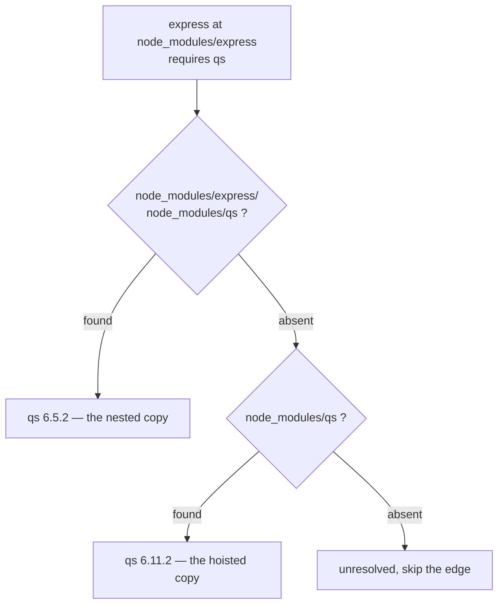
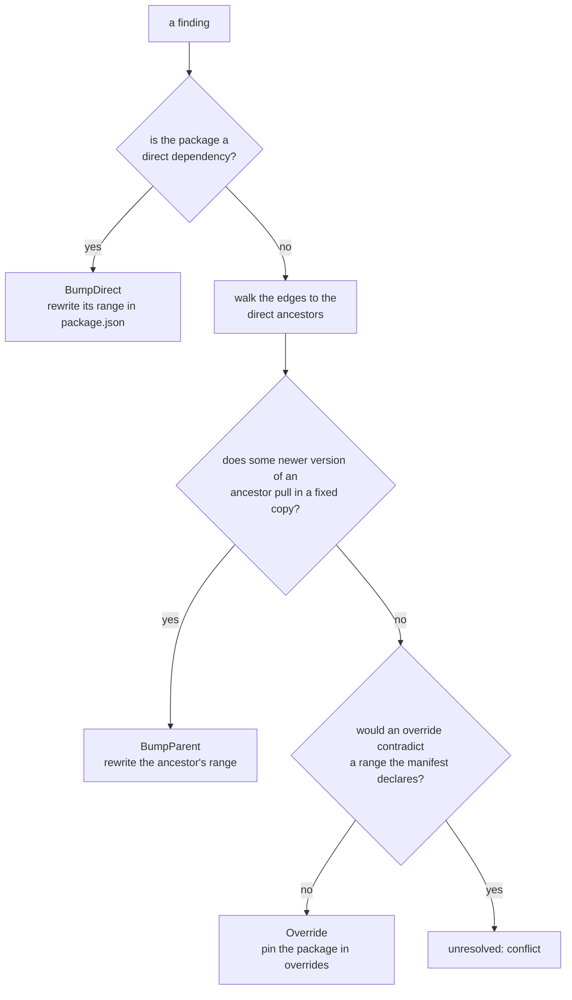
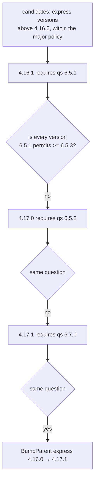
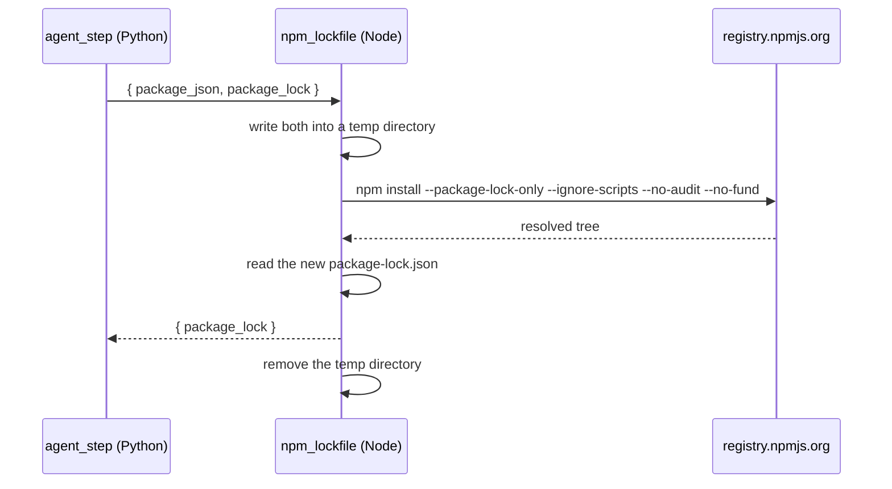

# Upgrade planning

Turning "these four packages are vulnerable" into "change these three lines in
`package.json`". This is the deterministic half of the agent: no model is
involved, and the same inputs always produce the same plan.

- [Parsing the lockfile](#parsing-the-lockfile)
- [The three kinds of fix](#the-three-kinds-of-fix)
- [Choosing a target version](#choosing-a-target-version)
- [Major bumps](#major-bumps)
- [Parent bumps](#parent-bumps)
- [Overrides and conflicts](#overrides-and-conflicts)
- [Merging actions](#merging-actions)
- [Applying the plan](#applying-the-plan)
- [Regenerating the lockfile](#regenerating-the-lockfile)

## Parsing the lockfile

npm's lockfile v2 and v3 both carry a `packages` map keyed by **install path**,
which is how the tree is encoded:

```json
{
  "packages": {
    "":                                 { "dependencies": { "express": "^4.16.0", "qs": "^6.11.0" } },
    "node_modules/express":             { "version": "4.16.0", "dependencies": { "qs": "6.5.2" } },
    "node_modules/express/node_modules/qs": { "version": "6.5.2" },
    "node_modules/qs":                  { "version": "6.11.2" }
  }
}
```

Two copies of `qs` are installed. Resolving which one `express` actually gets
means replaying Node's own lookup: check the requester's own `node_modules`,
then each ancestor's, then the hoisted copy at the root.



The resulting graph keeps both copies as distinct nodes, with distinct purls,
so an advisory affecting 6.5.2 does not implicate 6.11.2.

Other details the parser handles:

| Case | Behavior |
|---|---|
| Scoped names | `node_modules/@babel/core` keeps the scope; the purl encodes it as `%40babel/core` |
| Nested scoped | `node_modules/tool/node_modules/@scope/util` resolves correctly |
| Workspace links | `"link": true` entries are skipped; they have no version of their own |
| Workspace members | Entries outside `node_modules/` are skipped |
| Optional deps | An edge whose target was never installed is dropped silently |
| Peer deps | Produce edges, since they are installed |
| Dev deps | Only the root's count as edges; a package's own dev deps are not installed |
| Lockfile v1 | Refused with `UnsupportedLockfileError` telling you to regenerate |

Direct-ness comes from the root entry, not from depth: a package is direct when
resolving its name from the root lands on that exact node. In the example above
`qs 6.11.2` is direct and `qs 6.5.2` is not, even though both are installed.

## The three kinds of fix



Preference order is deliberate. A direct bump is the most honest change. A
parent bump is next, because it keeps the dependency tree internally
consistent. An override is last, because it pins a transitive package behind
its parent's back and can produce a combination nobody tested.

## Choosing a target version

The target is the **lowest published fix strictly above what is installed**.

```python
fixed_versions = ["3.9.0", "4.17.21", "4.18.0"]   # from OSV, ascending
installed = "4.17.20"
target = "4.17.21"                                 # not 4.18.0, not 3.9.0
```

Lowest, because the smallest change that clears the advisory is the one least
likely to break CI. Strictly above, because a "fix" at or below the installed
version is not a fix: if every published fix is already installed, the finding
is reported `no_fix` rather than producing a downgrade.

## Major bumps

A bump is breaking when the major changes, **or** when the major is 0 and the
minor changes. npm treats `0.x` as unstable, where a minor bump is allowed to
break the API, so `0.1.0 → 0.2.0` counts as major here.

| `allow_major_bumps` | Behavior |
|---|---|
| `false` (default) | The finding becomes `needs_major` and is listed in the PR body under "Not fixed" |
| `true` | The bump is taken, the package is listed in `major_bumps`, and the PR body warns about it |

When both a minor and a major fix are published, the minor wins regardless of
the setting, because the lowest-fix-above rule picks it first.

## Parent bumps

The hard case. `qs 6.5.2` is vulnerable, `express 4.16.0` depends on it, and
the fix is `qs 6.5.3`. Which version of express do we move to?



The subtlety is in the question being asked. It is **not** "does this range
allow a fixed version" — `^6.5.1` allows `6.5.3`, but it also allows `6.5.1`,
and a fresh resolve could pick either. The question is "is the **lowest**
version this range permits already at or above the fix", which is the only form
that guarantees no vulnerable copy can be installed.

When the registry has a version list for the package, that means
`min_satisfying`. When it does not and the range is an exact pin, the pin
itself is compared. Otherwise the candidate is rejected.

Candidates are tried lowest-first, so the smallest parent bump that works wins.
The search goes at most two levels deep below the candidate parent, because
each level costs registry round-trips and in practice the vulnerable package is
a direct dependency of the parent being bumped.

## Overrides and conflicts

When no parent version works, the fallback is npm's `overrides`:

```json
{
  "overrides": {
    "minimist": "1.2.6"
  }
}
```

This pins the package everywhere in the tree, regardless of what asks for it.
It is effective and occasionally wrong, which is why it is last.

A `conflict` is reported in exactly one case: the manifest itself declares a
range for that package, and the override target falls outside it. Writing the
override would then contradict a decision the project made explicitly, so the
planner refuses and the finding is reported unresolved instead.

Because npm's overrides can pin almost anything, `conflict` is rare by design.
The reason stays in the enum for ecosystems like Maven where
`dependencyManagement` genuinely conflicts.

## Merging actions

Several advisories often hit the same package. Actions are grouped by package
name and the **highest target version wins**; every advisory the merged action
clears is listed in `resolves`.

```
GHSA-a: lodash fixed in 4.17.19  ─┐
                                  ├─→  one BumpDirect to 4.17.21, resolves both
GHSA-b: lodash fixed in 4.17.21  ─┘
```

## Applying the plan

`package.json` is a file humans maintain, so the rewrite preserves:

- **key order** — `json.loads` keeps insertion order and the dump follows it
- **indentation** — detected from the original: two spaces, four spaces or tabs
- **the trailing newline** — present only if it was present before

The diff a reviewer sees is the version lines that changed and nothing else.

| Action | Edit |
|---|---|
| `BumpDirect` | The package's range in whichever section declares it |
| `BumpParent` | The parent's range, same way |
| `Override` | An entry in `overrides`, created if the section is absent |

Range style is preserved: `^4.17.20 → ^4.17.21`, `~1.6.0 → ~1.6.1`, an exact
pin stays exact. A range the agent cannot mirror, like `>=4.0.0 <5.0.0`,
becomes a caret range, which is npm's own default.

An action naming a package the manifest does not declare changes nothing. That
is the normal case for a transitive package reached through a parent bump: the
lockfile carries the change, not the manifest.

## Regenerating the lockfile

The Python runtime has no `npm`, so this is delegated to the one Node function
in the project:



`--ignore-scripts` is mandatory and is safety rule 5: `npm install` on an
untrusted manifest would otherwise run that project's lifecycle scripts inside
the function. `--package-lock-only` means nothing is actually downloaded into
`node_modules`, only resolved.

The Python side reaches this through a `LockfileRegenerator` protocol, so the
adapter does not know whether it is talking to an Appwrite function, a local
subprocess, or a stub in a test. The spec's fallback plan, a Docker worker with
both runtimes, slots in behind the same protocol if the Node function turns out
not to work.

If regeneration produces a lockfile identical to the current one, no patch is
emitted for it and only the manifest is committed.
